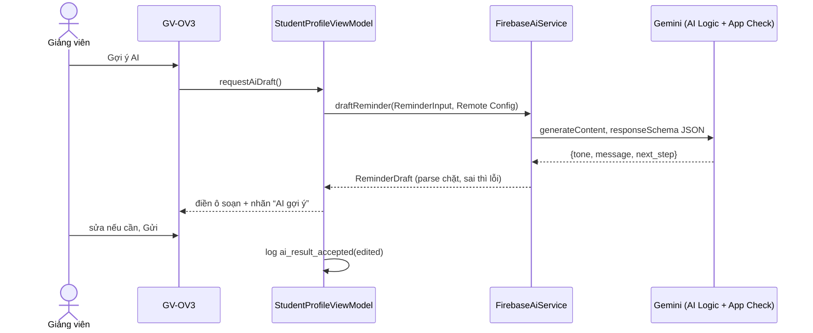

# Tính năng AI: gợi ý lời nhắc chuyên cần

> Đề Final mục 8, mức 2 (structured output, người dùng xác nhận).

## Giúp bước nào

Luồng FL-3 Chăm sóc sinh viên, màn GV-OV3 “Nhắc sinh viên”. Trước đây ô soạn chỉ có một câu mẫu cố định, thầy phải tự viết nếu muốn nói khác đi theo mức vắng. Nút “Gợi ý AI” tạo lời nhắc theo số buổi vắng, ngưỡng và số buổi còn lại.

## Cách chạy

## Đáp ứng đề

| Yêu cầu | Cách làm | Mã |
|---|---|---|
| Qua Firebase AI Logic (Gemini Developer API) | `FirebaseAI.googleAI()` | `mobile/lib/firebase/ai_service.dart` |
| App Check | `activateAppCheck()` chạy trước; AI Logic tự gắn token. Cần bật Enforce cho AI Logic trên console | `packages/core/lib/firebase/app_check_bootstrap.dart` |
| Model, prompt, cờ từ Remote Config | `ai_model`, `ai_reminder_prompt`, `ai_reminder_enabled` | `config_service.dart` |
| Lỗi quota, mạng không chặn luồng | Lỗi đổi thành `AppException`, ô soạn giữ câu mẫu, báo “…, dùng câu mẫu”, nút Gửi vẫn dùng được; có timeout 20 giây | `requestAiDraft()` |
| Không gửi dữ liệu cá nhân | `ReminderInput` chỉ có mã môn và 4 con số; kiểu dữ liệu không có chỗ cho tên, email, MSSV. Có test prompt | `models.dart`, `final_logic_test.dart` |
| Gắn nhãn, cho sửa | Dòng “AI gợi ý · kiểm tra trước khi gửi”, ô soạn là `AppTextField` | `student_screens.dart` |
| Sự kiện | `ai_request`, `ai_result_accepted`, `ai_error` | `analytics_service.dart` |

Tắt bằng Remote Config (`ai_reminder_enabled=false`): nút biến mất, GV-OV3 quay về bản Lab 2. Test TC-22.

## Ba đầu vào, đầu ra thật

Chạy trên thiết bị rồi chép nguyên văn vào đây. Chưa chạy nên còn trống.

| # | Đầu vào (môn, vắng/ngưỡng, đã học/tổng) | Đầu ra JSON | Thầy sửa gì |
|---|---|---|---|
| 1 | PRM393, 2/4, 6/20 | | |
| 2 | PRM393, 3/4, 10/20 | | |
| 3 | MMA301, 5/4, 14/20 | | |

## Một lỗi đã xử lý

Chạy trên thiết bị khi tắt mạng (hoặc đặt `ai_model` thành tên không tồn tại), chụp thông báo trên màn và sự kiện `ai_error` trong DebugView, chép vào đây. Mã xử lý đã có ở `requestAiDraft()`; cần bằng chứng chạy thật.
