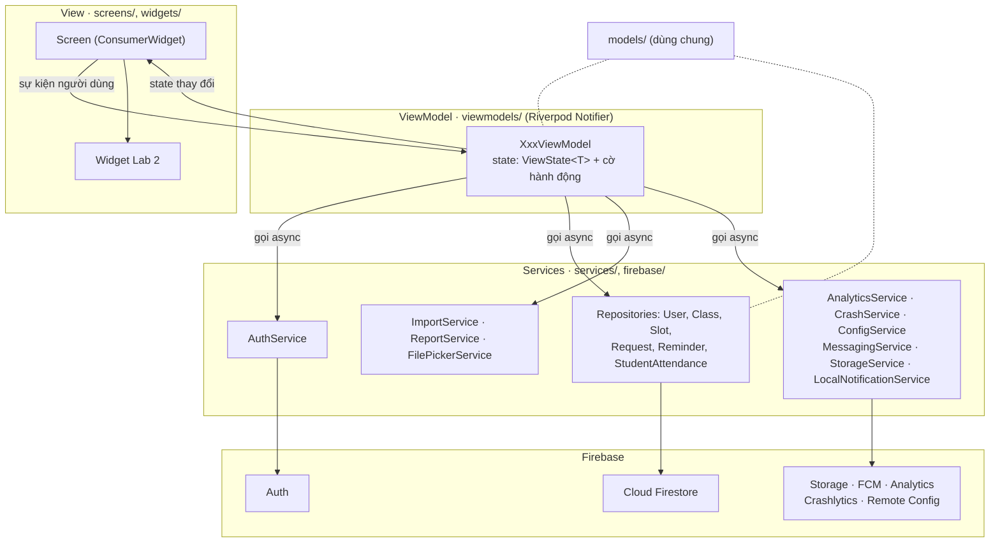

# Kiến trúc · Quick Attend (Lab 3)

MVVM với **Riverpod 3**. Phụ thuộc chỉ đi xuống: `screens/` và `widgets/` → `viewmodels/` → `services/`, `firebase/` → SDK. `models/` dùng chung, không phụ thuộc lớp nào.

## 1. Cấu trúc thư mục

```
lib/
├── main.dart            khởi tạo Firebase, Crashlytics, FCM nền, ProviderScope
├── app.dart             MaterialApp.router, theme, lắng nghe mở thông báo
├── router.dart          GoRouter: route theo trạng thái đăng nhập và vai trò
├── providers.dart       nơi duy nhất tạo service (DI); test ghi đè ở đây
├── config/              cấu hình build: portal (giảng viên / sinh viên), client ID Google
├── theme/               token Lab 2 → ColorScheme, TextTheme, AppSpace, AppRadius, StatusColors
├── models/              lớp dữ liệu thuần Dart + ViewState (loading, empty, error, data)
├── utils/               hàm thuần: kỳ học, định dạng ngày tiếng Việt, ngưỡng vắng, AppException
├── services/            interface + bản Firestore/Auth: auth, user, class, slot, request, reminder,
│                        student attendance; import file (parse), report PDF, chọn file
├── firebase/            bọc SDK Firebase khác: analytics, crashlytics, remote config, messaging,
│                        storage, thông báo cục bộ
├── viewmodels/          một Notifier mỗi màn; giữ state, gọi service, ghi analytics
├── screens/             auth/, lecturer/, student/, demo/: chỉ dựng UI từ state, gửi sự kiện lên VM
└── widgets/             component Lab 2: AppButton, QaCard, SlotCard, StatusChip, …
test/                    unit test ViewModel với service giả (fake), test parser và ngưỡng vắng
e2e_test/                bộ test ARTEMIS (pytest)
firebase/                firestore.rules, storage.rules, firestore.indexes.json, remote-config-defaults.json
```

## 2. Sơ đồ lớp



Luật được kiểm:
- Không screen hay widget nào import `firebase_*`, `cloud_firestore` hay gọi `FirebaseX.instance`. Chỉ file trong `services/` và `firebase/` được import SDK (kiểm bằng `grep` trong `docs/code-review.md`).
- Lọc, đếm, xếp hạng, kiểm tra hợp lệ nằm trong ViewModel hoặc service (ví dụ `AttendanceMath`, `ImportService`), không nằm trong `build()`.
- Mỗi màn tải dữ liệu có `ViewState<T>` (sealed: `Loading`, `Empty`, `Failure`, `Ready`) do ViewModel giữ.
- Service được tạo trong `providers.dart` và đọc qua `ref`, nên test ghi đè bằng `ProviderContainer(overrides: [...])`.

## 3. Sơ đồ tuần tự · FL-1 Điểm danh một slot (có sinh viên quét)

```mermaid
sequenceDiagram
    actor GV as Giảng viên
    participant SS as SessionScreen
    participant VM as SessionViewModel
    participant SR as SlotRepository
    participant FS as Cloud Firestore
    actor SV as Sinh viên (ScanScreen)
    participant SVM as ScanViewModel
    GV->>SS: mở /session/:slotId
    SS->>VM: build(slotId)
    VM->>SR: openSession(slotId, token)
    SR->>FS: update slots/{id} qrOpen, qrToken, qrExpiresAt
    VM->>SR: watchAttendance(slotId)
    SR-->>VM: Stream<List<AttendanceRecord>>
    loop mỗi N giây (Remote Config qr_rotate_seconds)
        VM->>SR: rotateToken(slotId)
        SR->>FS: update qrToken, qrExpiresAt
    end
    SV->>SVM: camera đọc "qa2|slotId|token|…thông tin slot"
    SVM->>FS: set slots/{id}/attendance/{MSSV} (token)
    Note over FS: Rules so token, hạn mã, MSSV trong lớp và các trường với slots/{id} (sinh viên không đọc được slot)
    FS-->>SR: snapshot mới
    SR-->>VM: danh sách đã quét
    VM-->>SS: state 33/35
    GV->>SS: Chốt (lần 1: đóng mã → .D2; lần 2: OV1 → Chốt)
    SS->>VM: close()
    VM->>SR: closeSession(slot, roster, present)
    SR->>FS: batch: attendance cho cả lớp (final), slots/{id}.closed
    alt mạng tốt
        FS-->>VM: ack → state .S, toast Hoàn tác
        VM->>VM: analytics attendance_close
    else quá 8 giây
        VM-->>SS: state .X (GV-OV2) "đã lưu trên máy"
        VM->>VM: Crashlytics recordError (non-fatal)
    end
```

## 4. ViewModel và service dùng

| ViewModel | Màn | Service |
|---|---|---|
| `AuthGate` (Provider) | router | AuthService, UserRepository |
| `LoginViewModel` | GV-090, SV-090 | AuthService, UserRepository, AnalyticsService, CrashService |
| `SignUpViewModel` | GV-091, SV-091 | AuthService, UserRepository, AnalyticsService |
| `VerifyEmailViewModel` | GV-092 | AuthService |
| `ForgotPasswordViewModel` | GV-094 | AuthService |
| `OverviewViewModel` | GV-001 | ClassRepository, SlotRepository, RequestRepository, ConfigService |
| `ScheduleViewModel` | GV-002 | SlotRepository |
| `ClassesViewModel` | GV-003 | ClassRepository, SlotRepository, ConfigService |
| `AccountViewModel` | GV-004, tài khoản SV | AuthService, UserRepository, LocalNotificationService, AnalyticsService |
| `ImportViewModel` | GV-100 | FilePickerService, ImportService, ClassRepository, UserRepository, AnalyticsService, CrashService |
| `SlotDetailViewModel` | GV-101 | SlotRepository, ClassRepository |
| `SessionViewModel` | GV-102 | SlotRepository, ClassRepository, ConfigService, AnalyticsService, CrashService |
| `ClassDetailViewModel` | GV-103 | ClassRepository, SlotRepository, ReportService, StorageService, ConfigService, AnalyticsService |
| `AttentionViewModel` | GV-104 | ClassRepository, SlotRepository, ConfigService |
| `RequestsViewModel` | GV-105 | RequestRepository, AnalyticsService |
| `StudentProfileViewModel` | GV-201 | SlotRepository, ClassRepository, ReminderRepository, ConfigService, AnalyticsService |
| `MyAttendanceViewModel` | SV-001, SV-002 | StudentAttendanceRepository, UserRepository, ConfigService |
| `ScanViewModel` | SV-101 | StudentAttendanceRepository, AnalyticsService, CrashService |
| `ReportViewModel` | SV-102 | RequestRepository, StudentAttendanceRepository, AnalyticsService |
| `FirebaseDemoViewModel` | demo | ReportService, StorageService, ConfigService, CrashService, MessagingService, ClassRepository |
| `NotificationsViewModel` | trung tâm thông báo | MessagingService |

## 5. Mô hình dữ liệu Firestore

| Đường dẫn | Trường chính | Ai ghi |
|---|---|---|
| `users/{uid}` | `role` (lecturer, student), `displayName`, `email`, `studentCode?`, `reminderBeforeSlot`, `reminderUnclosed`, `lastImportAt` | chính người đó (không đổi `role` sau khi tạo) |
| `classes/{classId}` | `lecturerId`, `term`, `subject`, `code`, `studentCount`, `totalSlots` | giảng viên chủ lớp |
| `classes/{classId}/students/{mssv}` | `name`, `studentCode`, `email` | giảng viên chủ lớp |
| `slots/{slotId}` | `lecturerId`, `classId`, `subject`, `classCode`, `term`, `start`, `end`, `slotNo`, `room`, `studentCount`, `closed`, `presentCount`, `absentCount`, `qrOpen`, `qrToken`, `qrExpiresAt` | giảng viên chủ slot |
| `slots/{slotId}/attendance/{mssv}` | `studentCode`, `studentName`, `present`, `source` (scan, manual, auto, correction), `final`, `token?` + trường sao chép của slot | giảng viên; sinh viên chỉ tạo bản ghi của mình khi mã còn hạn |
| `requests/{id}` | `studentUid`, `studentCode`, `lecturerId`, `slotId`, `classId`, `reason`, `note`, `status` (pending, approved, rejected), `rejectReason` | sinh viên tạo; giảng viên duyệt |
| `reminders/{id}` | `lecturerId`, `classId`, `studentCode`, `message`, `day` | giảng viên |

Ảnh và file: `reports/{uid}/{classId}-{yyyyMMdd-HHmm}.pdf` trên Cloud Storage. Luật ở `firebase/firestore.rules` và `firebase/storage.rules`.
