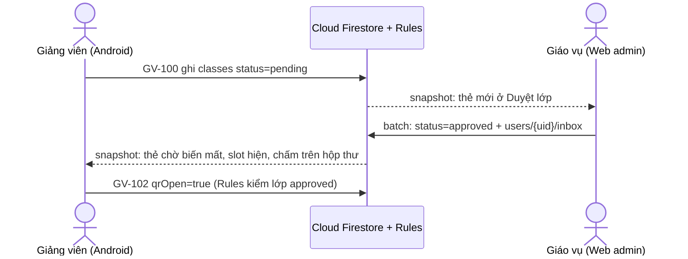

# Luồng liên vai trò

> Đề Final mục 3, Appendix C. Thời gian đo điền sau khi chạy trên bản đã deploy, 3 lần (`docs/test-report.md`). Chưa đo thì để trống, không ước lượng.

## Luồng 1: Duyệt lớp (bắt buộc)

Giảng viên nhập danh sách lớp trên app, giáo vụ kiểm trên web, app đổi ngay và có tin trong hộp thư. Lý do có bước này: giảng viên tự đăng ký được, nên một tài khoản bất kỳ không được mở mã điểm danh cho đến khi có người xác nhận lớp.

| # | Người, client | Màn | Ghi Firestore | Luật cho phép | Client kia thấy gì |
|---|---|---|---|---|---|
| 1 | Giảng viên, Android | GV-100 Nhập lớp → “Nhập” | `classes/{id}`: `status=pending`, `lecturerName`, `submittedAt`; `students`, `slots` | `classes` create: `isLecturer`, `status == 'pending'` | Web Duyệt lớp: thẻ mới hiện ngay, không cần tải lại |
| 2a | Giáo vụ, web | Duyệt lớp → “Duyệt” | Batch: `classes/{id}`: `status=approved`, `reviewedBy`, `reviewedAt`; `users/{lecturerId}/inbox/{new}` | `classes` update staff `pending → approved`; `inbox` create `isStaff` | App: thẻ “Chờ giáo vụ duyệt” biến mất, slot hiện ở Tổng quan và Lịch, chấm đỏ trên nút thư |
| 2b | Giáo vụ, web | Duyệt lớp → “Từ chối” + lý do | Batch: `status=rejected`, `rejectReason`, tin hộp thư | Như trên, có `rejectReason` | App: thẻ hổ phách kèm lý do và nút “Nhập lại” |
| 3 | Giảng viên, Android | Hộp thư → tin “đã được duyệt” | `users/{uid}`: `lastInboxReadAt` | `users` update chính mình | Mở GV-103 lớp vừa duyệt |
| 4 | Giảng viên, Android | GV-102 “Điểm danh” | `slots/{id}`: `qrOpen=true` | `slots` update: `classApproved` | Trước khi duyệt, Rules từ chối ghi này (ca Rules “mở mã khi lớp chưa duyệt”) |

### Thời gian đo (ghi ở bước 2a, cập nhật thấy trên app)

| Lần | Giáo vụ bấm Duyệt | App đổi | Chênh lệch |
|---|---|---|---|
| 1 | | | |
| 2 | | | |
| 3 | | | |

Cách đo: quay màn hình cả hai thiết bị cùng khung, đếm khung hình. Sơ đồ quay nằm ở video demo.

## Luồng 2: Báo sai (điểm thưởng)

Có sẵn từ Lab 2 (FL-4, FL-4b): sinh viên trên web gửi báo sai, giảng viên trên app duyệt, web sinh viên cập nhật ngay.

| # | Người, client | Màn | Ghi Firestore | Luật cho phép | Client kia thấy gì |
|---|---|---|---|---|---|
| 1 | Sinh viên, web | SV-102 | `requests/{slot_mssv}`: `status=pending` | `requests` create: `isStudent`, đúng MSSV | App: ô “yêu cầu sửa” tăng, GV-105 có thẻ mới |
| 2 | Giảng viên, Android | GV-105 “Duyệt” | Batch: `requests.status=approved`; `attendance.present=true`; `slots.presentCount+1` | `requests` update `pending → approved`; `attendance` update `ownsSlot` | Web: SV-002 buổi đó đổi thành “Có mặt”, tỉ lệ tăng |

Đo thời gian như trên.

| Lần | Giảng viên bấm Duyệt | Web đổi | Chênh lệch |
|---|---|---|---|
| 1 | | | |
| 2 | | | |
| 3 | | | |
