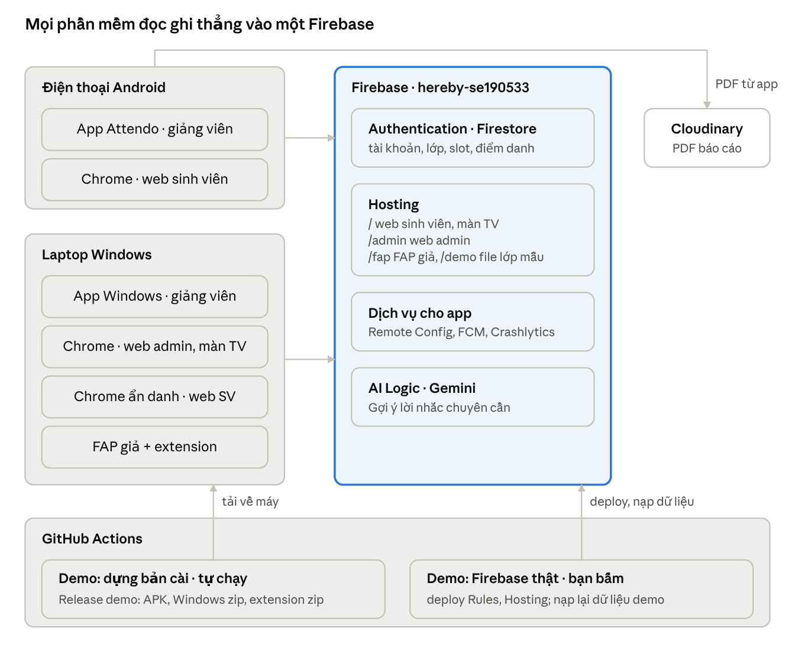

<!-- Bản repo của Doc "Attendo · Hướng dẫn cài đặt, test tay và demo toàn hệ thống"
     (https://claude.ai/artifact/9ZLXimzdaxz3wx61uBCL6U). Repo là bản gốc: sửa ở đây rồi cập nhật Doc. -->

# Attendo · Hướng dẫn cài đặt, test tay và demo toàn hệ thống

08/11/2026 · thien

Trước khi giao tài liệu này, AI đã tự chạy 31 ca test bấm tự động trên cùng mã nguồn và cùng dữ liệu demo, trong đó có hai ca đi đúng thứ tự các luồng bên dưới, và đã sửa các lỗi tìm được. Phần chỉ chạy được trên điện thoại thật, máy Windows thật và Firebase thật thì AI chưa kiểm được; bảng ca test ghi rõ từng phần.

## Đọc trước

Làm theo đúng thứ tự các phần: Cài đặt một lần (khoảng 40 phút, chỉ làm một lần) → Trước mỗi buổi (nạp lại dữ liệu, kiểm khói 10 phút) → Các luồng test tay L1 đến L18 (khoảng 2 giờ) → Ghi lỗi. Phần Kịch bản demo dùng cho buổi thuyết trình và quay video.

| Phần | AI đã làm gì | Bằng chứng |
| --- | --- | --- |
| Web sinh viên, web admin, app giảng viên (bản web cùng mã với Android và Windows) | Chạy tự động mọi luồng trên Firebase Emulator, kể cả hai ca W70, W71 đi đúng tài liệu này | [CI E2E builds, 31 ca đạt](https://github.com/thiengthb/PRM393_Lab03_SE190533/actions/runs/42465928241) |
| FAP giả + extension | Chạy tự động: chốt trên app → extension lấy bản đã chốt → điền đúng số em có mặt; slot sai bị chặn | Ca W60 trong cùng lần CI |
| File cài | GitHub dựng được APK, Windows zip, extension zip | [Release thử demo-preview](https://github.com/thiengthb/PRM393_Lab03_SE190533/releases/tag/demo-preview) |
| App Android, app Windows chạy thật; camera; FCM; Crashlytics; Gợi ý AI thật | Chưa kiểm: máy của AI không chạy được Android, Windows hay Firebase thật | Bạn kiểm ở kiểm khói và L17 |
| Firebase thật: Rules, chỉ mục, Hosting, dữ liệu demo | Viết sẵn workflow một nút bấm; chưa chạy vì cần khoá của bạn | Bạn chạy ở Cài đặt, bước 4 |

Các lỗi AI tìm được và trạng thái của chúng nằm ở [docs/demo/loi.md](https://github.com/thiengthb/PRM393_Lab03_SE190533/blob/final-system/docs/demo/loi.md). Hai lỗi còn mở ảnh hưởng tới cách test, tài liệu đã dặn cách tránh: chỉ một máy giảng viên mở màn phiên tại một thời điểm (LOI-05), và kéo lên đầu màn khi không thấy số đã có mặt (LOI-06).

## Hệ thống gồm những gì

Bạn cần hai máy: một điện thoại Android và một laptop Windows có Chrome. Mọi phần mềm đọc và ghi thẳng vào Firebase project **hereby-se190533** (gói miễn phí Spark), không có máy chủ riêng, nên thay đổi trên máy này hiện sang máy kia trong vài giây. File PDF báo cáo đi thẳng từ app lên Cloudinary vì gói Spark không có Cloud Storage.

Mũi tên từ hai máy vào Firebase là đọc và ghi trực tiếp; GitHub chỉ dựng file cài và đẩy dữ liệu khi được bấm.

| Phần mềm | Chạy ở đâu | Ai dùng | Lấy ở đâu |
| --- | --- | --- | --- |
| App Attendo (Android) | Điện thoại | Giảng viên | Attendo-GiangVien.apk trên [Release demo](https://github.com/thiengthb/PRM393_Lab03_SE190533/releases/tag/demo) |
| App Attendo (Windows) | Laptop | Giảng viên, khi dạy có máy chiếu | Attendo-Windows.zip trên Release demo |
| Web sinh viên | Chrome trên điện thoại hoặc laptop | Sinh viên | [hereby-se190533.web.app](https://hereby-se190533.web.app) |
| Màn chiếu TV | Chrome trên laptop nối máy chiếu | Cả lớp nhìn | Link /tv/... lấy từ nút Chiếu lên TV trong app |
| Web admin | Chrome trên laptop | Quản trị | [hereby-se190533.web.app/admin](https://hereby-se190533.web.app/admin/) |
| FAP giả | Chrome trên laptop | Giảng viên | [hereby-se190533.web.app/fap](https://hereby-se190533.web.app/fap/) |
| Extension Attendo cho FAP | Chrome trên laptop | Giảng viên | Attendo-extension.zip trên Release demo |

Hai workflow trên GitHub làm thay phần cài đặt khó: **Demo: dựng bản cài** tự chạy mỗi khi `final-system` có code mới và đăng file cài lên trang Release; **Demo: Firebase thật** chỉ chạy khi bạn bấm, để đẩy web lên Firebase và nạp lại dữ liệu demo. Bản Windows thiếu đăng nhập Google, FCM, Crashlytics và Gợi ý AI (FlutterFire trên Windows chưa có các phần này); muốn thử các phần đó thì dùng điện thoại.

## Tài khoản và dữ liệu demo

Mọi tài khoản dưới đây dùng chung mật khẩu **Demo@123**, đã xác nhận email sẵn. Mỗi lần bấm "nạp lại dữ liệu" (phần Trước mỗi buổi), mật khẩu được đặt lại về Demo@123 và dữ liệu quay về đúng như bảng này.

| Vai trò | Email | Tên trong app | Dùng ở đâu | Có sẵn gì |
| --- | --- | --- | --- | --- |
| Giảng viên chính | quanm@fe.edu.vn | Nguyễn Minh Quân | App Android, app Windows, extension | 4 lớp đã duyệt (bảng dưới), 1 slot **đang diễn ra** của PRM393 SE1801, 2 slot quên chốt, 3 yêu cầu báo sai đang chờ |
| Giảng viên thứ hai | nam@fe.edu.vn | Lê Hoàng Nam | App Android hoặc Windows | Lớp MMA301 SE1806 (6 sinh viên) **đang chờ duyệt** |
| Sinh viên 1 | dung101@fpt.edu.vn | Huỳnh Anh Dung, SE190101 | Web sinh viên (điện thoại hoặc laptop) | Lớp PRM393 SE1801, đã vắng 3 buổi (sắp chạm ngưỡng); 1 báo sai đang chờ, 1 bị từ chối, 1 buổi vắng chưa báo |
| Sinh viên 2 | tien102@fpt.edu.vn | Dương Hữu Tiến, SE190102 | Web sinh viên | Đã vắng 5 buổi, quá ngưỡng (đã fail) |
| Quản trị | admin@fe.edu.vn | Quản trị Attendo | Web admin | Duyệt lớp, môn học, thông báo, người dùng, sự cố |
| Giáo vụ | giaovu@fe.edu.vn | Phòng Giáo vụ | (không dùng) | Bản này web admin chỉ mở cho Quản trị, giáo vụ đăng nhập sẽ bị chặn. Dùng để thử đúng điều đó |
| Tự đăng ký lúc test | \<gmail của bạn>+demogv@gmail.com, \<gmail của bạn>+demosv@gmail.com | tuỳ bạn đặt | App (giảng viên), web (sinh viên) | Thư xác nhận gửi về hộp Gmail thật của bạn. Mọi tài khoản có **+demo** trong email bị xoá khi nạp lại dữ liệu, nên luồng đăng ký làm lại được |

**Lớp của giảng viên Nguyễn Minh Quân** (kỳ Fall 2026, bắt đầu 07/09/2026, 10 tuần, mỗi lớp 20 slot, ngưỡng vắng 20% = được vắng 4 buổi):

| Lớp | Sĩ số | Lịch trong file | Điểm đáng chú ý |
| --- | --- | --- | --- |
| PRM393 · SE1801 | 35 | Thứ Ba và thứ Năm, slot 1, P.305 | Khi nạp lại, lớp này được dời sang **slot đang diễn ra hôm nay** (24 em đã quét sẵn). SE190102 vắng 5 (fail), SE190103 vắng 4 (hết lượt vắng), SE190101 và SE190104 vắng 3 |
| PRM393 · SE1802 | 34 | Thứ Hai và thứ Tư, slot 2, P.306 | Slot gần nhất **chưa chốt** (luồng "quên chốt") |
| MMA301 · SE1805 | 30 | Thứ Ba slot 3, thứ Sáu slot 1, P.402 | Dữ liệu bình thường |
| PRN221 · SE1810 | 32 | Thứ Tư slot 4, thứ Sáu slot 3, P.210 | Slot gần nhất **chưa chốt** |

Giờ các slot: 1 = 7:00, 2 = 9:30, 3 = 12:30, 4 = 15:00, 5 = 17:30, 6 = 20:00. Nếu bạn nạp lại dữ liệu ngoài giờ học, script tự tạo một slot bắt đầu 30 phút trước lúc nạp và kéo dài 2 giờ 15 phút, nên **slot đang diễn ra còn khoảng 1 giờ 45 phút sau khi nạp**.

**File lớp mẫu** để thử nhập lớp, tải thẳng bằng trình duyệt trên điện thoại hoặc laptop:

- [lop-fall-2026.csv](https://hereby-se190533.web.app/demo/lop-fall-2026.csv): 4 lớp, 131 sinh viên, file đúng.
- [lop-co-loi.csv](https://hereby-se190533.web.app/demo/lop-co-loi.csv): 4 dòng có lỗi (trùng mã, thiếu mã), để xem màn báo lỗi.

Hai link này chỉ mở được sau lần deploy đầu tiên (phần Cài đặt một lần, bước 2).

## Cài đặt một lần

Làm 6 bước này một lần, theo đúng thứ tự, khoảng 40 phút. Laptop không cần Flutter, Node hay Android Studio: mọi thứ đã được GitHub dựng sẵn. Bước nào không ra đúng chữ "Đúng khi", dừng lại, chụp màn hình và gửi cho Claude, đừng tự sửa.

### Bước 1. Đổi nhánh mặc định của repo sang final-system (1 phút)

Nút "Run workflow" của GitHub chỉ hiện với workflow nằm trên nhánh mặc định, mà nhánh mặc định đang là `main` (bản Lab 3 màu cam, không có các workflow demo).

- [ ] Mở [Settings → General](https://github.com/thiengthb/PRM393_Lab03_SE190533/settings) của repo.
- [ ] Mục **Default branch** → bấm biểu tượng hai mũi tên → chọn `final-system` → **Update** → "I understand, update the default branch".

Đúng khi: trang chính của repo hiện nhánh `final-system`. Nhánh `main` vẫn còn nguyên, chỉ không còn là nhánh mở ra đầu tiên.

### Bước 2. Khoá cho GitHub (10 phút)

GitHub cần một khoá "service account" để thay bạn đẩy Rules, Hosting và nạp dữ liệu vào Firebase. Khoá này có quyền lớn với project: không gửi file khoá cho ai (kể cả Claude), không đưa vào repo, không dán vào chat.

- [ ] Đăng nhập trình duyệt bằng tài khoản Google **tranngocthien024@gmail.com** (tài khoản sở hữu project Firebase).
- [ ] Mở [Firebase → Project settings → Service accounts](https://console.firebase.google.com/project/hereby-se190533/settings/serviceaccounts/adminsdk) → **Generate new private key** → **Generate key**. Một file `hereby-se190533-firebase-adminsdk-....json` tải về thư mục Downloads.
- [ ] Cấp quyền cho khoá: mở [Google Cloud → IAM](https://console.cloud.google.com/iam-admin/iam?project=hereby-se190533) → tick **Include Google-provided role grants** nếu có → tìm dòng `firebase-adminsdk-...@hereby-se190533.iam.gserviceaccount.com` → bấm hình cây bút → **Add another role** → gõ và chọn **Firebase Admin** → **Add another role** → chọn **Service Usage Consumer** → **Save**.
- [ ] Mở file .json bằng Notepad (chuột phải → Open with → Notepad) → Ctrl+A → Ctrl+C.
- [ ] Mở [GitHub → Settings → Secrets and variables → Actions](https://github.com/thiengthb/PRM393_Lab03_SE190533/settings/secrets/actions) → **New repository secret** → Name: `FIREBASE_SERVICE_ACCOUNT` (gõ đúng từng chữ) → Secret: Ctrl+V → **Add secret**.
- [ ] Xoá file .json trong Downloads và dọn thùng rác.

Đúng khi: trang Secrets có dòng `FIREBASE_SERVICE_ACCOUNT`.

### Bước 3. Kiểm tra Firebase console (5 phút)

- [ ] [Authentication → Sign-in method](https://console.firebase.google.com/project/hereby-se190533/authentication/providers): **Email/Password** đang Enabled. Google cũng Enabled nếu bạn muốn thử đăng nhập Google.
- [ ] [App Check → APIs](https://console.firebase.google.com/project/hereby-se190533/appcheck/apis): **Cloud Firestore** và **Firebase AI Logic** đều ghi **Unenforced**. Nếu ô nào ghi Enforced, bấm vào đó → Unenforce. Lý do: bản APK và bản web dựng cho demo không có chứng thực App Check, nên khi Enforced thì mọi màn sẽ báo lỗi quyền.
- [ ] [AI Logic](https://console.firebase.google.com/project/hereby-se190533/ailogic): đã bật Gemini Developer API (cần cho nút Gợi ý AI). Chưa bật thì bấm Get started và chọn Gemini Developer API (gói miễn phí).
- [ ] Tuỳ chọn, chỉ khi muốn đăng nhập Google trên điện thoại: [Project settings → General](https://console.firebase.google.com/project/hereby-se190533/settings/general) → app Android `vn.edu.fpt.quick_attend` → **Add fingerprint** → dán dòng SHA1 ghi trong trang [Release demo](https://github.com/thiengthb/PRM393_Lab03_SE190533/releases/tag/demo).

### Bước 4. Đẩy hệ thống lên Firebase và nạp dữ liệu (bấm một nút, đợi 8 phút)

- [ ] Mở [Actions → Demo: Firebase thật](https://github.com/thiengthb/PRM393_Lab03_SE190533/actions/workflows/demo-firebase.yml) → **Run workflow** → Branch: `final-system` → giữ tick cả hai ô (Đẩy Rules..., Xoá sạch dữ liệu...) → **Run workflow**.
- [ ] Tải lại trang sau vài giây, bấm vào lần chạy mới nhất, đợi vòng vàng chuyển thành dấu tick xanh.

Đúng khi: tick xanh, và phần **Summary** ghi các link web cùng dòng "Xong. Giảng viên quanm@fe.edu.vn ... Slot đang diễn ra: N". Nếu ra dấu x đỏ: gửi link của lần chạy đó cho Claude (log không chứa khoá).

### Bước 5. Điện thoại Android: app giảng viên và web sinh viên (10 phút)

- [ ] Nếu máy đã có app cũ (Quick Attend, Hereby hay Attendo cài từ laptop): giữ biểu tượng → **Gỡ cài đặt**. Bản cũ ký bằng khoá khác nên không cài đè được.
- [ ] Dùng Wi-Fi. Mở Chrome trên điện thoại → vào [trang Release demo](https://github.com/thiengthb/PRM393_Lab03_SE190533/releases/tag/demo) → bấm **Attendo-GiangVien.apk** (khoảng 85 MB) → Tải xuống.
- [ ] Tải xong bấm **Mở**. Nếu máy hỏi quyền cài từ nguồn này: **Cài đặt** → bật **Cho phép từ nguồn này** cho Chrome → quay lại → **Cài đặt**. Nếu Play Protect cảnh báo ứng dụng không xác định: **Chi tiết khác → Vẫn cài đặt**.
- [ ] Mở app **Attendo** → đăng nhập quanm@fe.edu.vn / Demo@123. Nếu app hỏi quyền thông báo, bấm Cho phép.
- [ ] Thêm web sinh viên: Chrome trên điện thoại → [hereby-se190533.web.app](https://hereby-se190533.web.app) → menu ba chấm → **Thêm vào màn hình chính**. Chưa cần đăng nhập.

Đúng khi: app mở màn Tổng quan có thẻ "Đang diễn ra: PRM393 · SE1801".

### Bước 6. Laptop: app Windows, extension, web admin (15 phút)

App Windows:

- [ ] Từ [trang Release demo](https://github.com/thiengthb/PRM393_Lab03_SE190533/releases/tag/demo) tải **Attendo-Windows.zip**.
- [ ] Chuột phải file zip → **Extract All** → đường dẫn `C:\Attendo` → Extract. Phải giải nén cả thư mục; chạy thẳng trong file zip sẽ lỗi thiếu file.
- [ ] Mở `C:\Attendo` → nháy đúp **hereby.exe**. Nếu Windows hiện "Windows protected your PC": **More info → Run anyway**.
- [ ] Đăng nhập quanm@fe.edu.vn / Demo@123 (bản Windows không có nút Google).

Extension "Attendo cho FAP":

- [ ] Tải **Attendo-extension.zip** → Extract All vào `C:\Attendo-extension`. Giữ thư mục này, Chrome đọc extension từ đó.
- [ ] Chrome → gõ `chrome://extensions` → bật **Developer mode** (góc phải trên) → **Load unpacked** → chọn thư mục `C:\Attendo-extension` (thư mục có file manifest.json) → Select Folder.
- [ ] Bấm biểu tượng mảnh ghép trên thanh Chrome → ghim **Attendo cho FAP**.

Web admin và cửa sổ cho sinh viên:

- [ ] Chrome thường: mở [hereby-se190533.web.app/admin](https://hereby-se190533.web.app/admin/) → đăng nhập admin@fe.edu.vn / Demo@123.
- [ ] Web sinh viên trên laptop luôn mở trong **cửa sổ ẩn danh** (Ctrl+Shift+N). Web sinh viên và web admin nằm chung một địa chỉ, nên mở chung một cửa sổ thì đăng nhập bên này có thể đá bên kia ra (chưa kiểm, để an toàn thì tách cửa sổ).

Đúng khi: app Windows hiện Tổng quan của Nguyễn Minh Quân; web admin hiện Tổng quan có "1 lớp chờ duyệt"; trang chrome://extensions có "Attendo cho FAP" không báo lỗi đỏ.

Khi có bản mới (Claude báo), làm lại: cài đè APK (không cần gỡ nếu khoá không đổi), giải nén đè `C:\Attendo`, giải nén đè `C:\Attendo-extension` rồi bấm nút tải lại (mũi tên vòng) của extension trong chrome://extensions.

## Trước mỗi buổi test hoặc demo

Mỗi lần test xong, dữ liệu đã đổi (slot đã chốt, yêu cầu đã duyệt). Trước mỗi buổi, nạp lại để mọi thứ quay về đúng phần Tài khoản và dữ liệu demo, rồi kiểm khói 10 phút.

### Nạp lại dữ liệu (1 phút)

- [ ] [Actions → Demo: Firebase thật](https://github.com/thiengthb/PRM393_Lab03_SE190533/actions/workflows/demo-firebase.yml) → **Run workflow** → Branch `final-system` → **bỏ tick** ô "Đẩy Rules..." (chỉ cần khi Claude báo có bản web mới), giữ tick ô "Xoá sạch dữ liệu..." → **Run workflow** → đợi tick xanh.
- [ ] Đọc dòng cuối trong Summary: "Slot đang diễn ra: N". Ghi nhớ số N, lát nữa chọn đúng slot N trên FAP giả.

Bấm nút này **trong vòng 30 phút trước khi bắt đầu**: slot đang diễn ra chỉ kéo dài khoảng 1 giờ 45 phút sau lúc nạp. Không cần đăng xuất app trên điện thoại hay laptop: tài khoản mẫu được giữ, chỉ dữ liệu đổi. Firebase gói miễn phí cho khoảng 20.000 lượt ghi mỗi ngày, mỗi lần nạp tốn khoảng 5.000 (xoá cũ và ghi mới), nên **nạp tối đa 3 lần mỗi ngày**.

### Kiểm khói 10 phút

Kiểm khói là bấm nhanh mỗi phần mềm một lần để biết nó còn sống, trước khi đi vào luồng dài. Mục nào sai thì chụp màn hình gửi Claude trước khi test tiếp.

- [ ] **Điện thoại, app Attendo** (quanm): Tổng quan có thẻ "Đang diễn ra: PRM393 · SE1801", dòng "3 yêu cầu sửa" và "2 slot chưa chốt".
- [ ] **Laptop, app Windows** (quanm): cùng Tổng quan như trên điện thoại, thanh tab nằm dọc bên trái.
- [ ] **Laptop, cửa sổ ẩn danh, web sinh viên** (dung101): danh sách Môn học có PRM393 SE1801 với "vắng 3 trên 4".
- [ ] **Laptop, web admin** (admin): Tổng quan ghi "4 lớp đã duyệt" và "1 lớp chờ duyệt".
- [ ] **Laptop, FAP giả + extension**: mở [hereby-se190533.web.app/fap](https://hereby-se190533.web.app/fap/) → bấm biểu tượng Attendo cho FAP → bảng bên phải mở ra → **Đọc trang** → hiện "Đã đọc ... sinh viên".
- [ ] **Điện thoại, app, Khu demo** (Tài khoản → Firebase → Khu demo): có dòng FCM token và các tham số Remote Config (qr\_rotate\_seconds = 12).
- [ ] **Điện thoại, app, Gợi ý AI**: Tổng quan → Vắng nhiều → Xem tất cả → Sắp chạm → em đầu tiên → **Nhắc nhở** → **Gợi ý AI** → ô soạn đổi thành lời nhắc do AI viết. Không bấm Gửi, bấm quay lại.

## Các luồng test tay

Làm từ L1 đến L18 theo đúng thứ tự, ngay sau một lần nạp lại dữ liệu, hết khoảng 2 giờ. Thứ tự này đã tính sẵn để luồng trước không làm hỏng dữ liệu của luồng sau; đảo thứ tự thì một vài con số "Đúng khi" sẽ lệch. Muốn làm lại từ đầu: nạp lại dữ liệu.

Ký hiệu thiết bị: **ĐT-app** = app Attendo trên điện thoại; **ĐT-web** = Chrome trên điện thoại mở web sinh viên; **LT-win** = app Windows; **LT-admin** = Chrome thường mở web admin; **LT-sv** = Chrome ẩn danh mở web sinh viên; **LT-fap** = Chrome thường mở FAP giả và extension. Chữ **in đậm** là chữ trên nút hoặc trên màn, gõ đúng như vậy. Mỗi ô tick là một bước; dòng "Đúng khi" là kết quả phải thấy.

### Phần A. Giảng viên điểm danh một slot

**L1. Đăng nhập (LT-win)**

- [ ] Tài khoản → **Đăng xuất** → hộp hỏi **Đăng xuất?** → **Đăng xuất**. Đúng khi: về màn đăng nhập.
- [ ] Gõ quanm@fe.edu.vn và mật khẩu SaiMatKhau1 → **Đăng nhập**. Đúng khi: hiện **Sai email hoặc mật khẩu**.
- [ ] **Quên mật khẩu?** → gõ quanm@fe.edu.vn → **Gửi link đặt lại**. Đúng khi: hiện **Đã gửi link** (hộp thư fe.edu.vn là giả nên không ai nhận thư, chỉ kiểm màn). Quay lại.
- [ ] Đăng nhập đúng quanm@fe.edu.vn / Demo@123. Đúng khi: Tổng quan.

**L2. Tổng quan và bốn tab (ĐT-app)**

- [ ] Tổng quan. Đúng khi: có **Đang diễn ra: PRM393 · SE1801**, **3 yêu cầu sửa**, **2 slot chưa chốt**, khối Vắng nhiều, lịch tháng có chấm.
- [ ] Tab **Điểm danh** → **Tuần sau** → **Tuần trước** hai lần. Đúng khi: dải ngày đổi theo tuần, bấm một ngày thì hiện slot của ngày đó.
- [ ] Tab **Lớp** → **PRM393 · SE1801, 35 sinh viên**. Đúng khi: dòng "đã học ... trên 20 buổi"; tab **Buổi học** liệt kê các buổi, mỗi buổi có "Slot · phòng" và "... trên 35".
- [ ] Tab **Tài khoản**. Đúng khi: có hồ sơ, nhóm Giao diện, nhóm Firebase và hàng đỏ **Đăng xuất** tách riêng.

**L3. Mở phiên, sinh viên nhập mã số (ĐT-app + LT-sv)**

- [ ] ĐT-app: Tổng quan → bấm thẻ **Đang diễn ra**. Đúng khi: màn phiên có mã QR, dòng **Mã số** 6 chữ số và **24 trên 35 đã có mặt**. Mã đổi mỗi 12 giây.
- [ ] LT-sv: mở cửa sổ ẩn danh → bấm phím **Windows + mũi tên trái** để cửa sổ chiếm nửa màn hình. Cửa sổ rộng hơn 900 px thì web sinh viên hiện bố cục laptop, chỉ có dòng mờ "Quét mã trên điện thoại" và không có nút Quét mã; đó là thiết kế, không phải lỗi.
- [ ] LT-sv: mở [hereby-se190533.web.app](https://hereby-se190533.web.app) → đăng nhập dung101@fpt.edu.vn / Demo@123 → **Quét mã** → nếu trình duyệt hỏi camera thì bấm Chặn → **Nhập mã** → gõ 000000 → **Gửi**. Đúng khi: **Mã không đúng hoặc đã hết hạn**.
- [ ] LT-sv: **Nhập lại** → gõ mã số đang hiện trên ĐT-app → **Gửi**. Đúng khi: LT-sv hiện **Đã ghi nhận**; ĐT-app tự đổi thành **25 trên 35 đã có mặt** trong vài giây. Mã vừa đổi vẫn được nhận, nên gõ chậm một chút cũng không sao.

**L4. Chiếu lên TV, sinh viên quét QR bằng camera (LT-win + ĐT-web)**

- [ ] **Quy tắc:** tại mỗi thời điểm chỉ **một** máy giảng viên để màn phiên mở. Máy đang để màn phiên là máy đổi mã; hai máy cùng mở thì cả hai cùng đổi mã, và mã sinh viên nhìn trên máy này có thể đã bị máy kia thay (sinh viên nhận "Mã đã hết hạn"). Vì vậy: ĐT-app bấm **Quay lại** về Tổng quan trước.
- [ ] LT-win: Tổng quan → thẻ **Đang diễn ra**. Đúng khi: cùng phiên, **25 trên 35 đã có mặt**.
- [ ] LT-win: **Chiếu lên TV** → **Chép link** → dán vào một tab Chrome mới → F11 cho toàn màn hình. Đúng khi: trang TV có mã QR lớn, mã số và số đã có mặt. Link có dạng hereby-se190533.web.app/tv/ kèm 10 ký tự (gõ tay được trên máy phòng học).
- [ ] ĐT-web: Chrome → [hereby-se190533.web.app](https://hereby-se190533.web.app) → đăng nhập tien102@fpt.edu.vn / Demo@123 → **Quét mã** → cho phép camera → hướng camera vào QR trên màn laptop. Đúng khi: **Đã ghi nhận**; LT-win và trang TV lên **26 trên 35**. Camera không đọc được thì dùng **Nhập mã** với mã số trên TV.
- [ ] LT-win: **Quay lại** về Tổng quan, giao màn phiên lại cho điện thoại. ĐT-app: thẻ **Đang diễn ra**. Đúng khi: **26 trên 35 đã có mặt** (kéo lên đầu màn nếu không thấy dòng này).
- [ ] Tuỳ chọn: trong tab Chrome khác mở hereby-se190533.web.app/tv/ABCDEFGHJK (khoá bịa). Đúng khi: hiện **Chưa mở điểm danh** hoặc báo link hết hạn.

**L5. Đóng mã, bật tay, chốt, hoàn tác (ĐT-app)**

- [ ] **Đóng mã**. Đúng khi: nút đổi thành **Mở lại mã** và **Chốt**; trang TV báo đã đóng mã.
- [ ] **Mở lại mã** → mã hiện lại (TV cũng có mã) → **Đóng mã** lần nữa.
- [ ] Trong mục **Chưa quét**, bật công tắc của **Vũ Thu Tiến** (SE190103). Đúng khi: kéo lên đầu màn thấy **27 trên 35 đã có mặt**.
- [ ] **Chốt**. Đúng khi: **Đã chốt**, có thông báo kèm nút **Hoàn tác** trong vài giây.
- [ ] **Hoàn tác**. Đúng khi: quay về màn có **Mở lại mã**, vẫn 27 trên 35.
- [ ] **Chốt** → đợi hết thông báo → **Xong**. Đúng khi: về Tổng quan, không còn thẻ "Đang diễn ra" có nút điểm danh.

**L6. Extension điền điểm danh vào FAP giả (LT-fap)**

- [ ] Mở [hereby-se190533.web.app/fap](https://hereby-se190533.web.app/fap/) → ô **Ngày** để hôm nay → ô **Buổi** chọn **PRM393 · SE1801 · Slot N · P.305** (N là số ghi trong Summary lúc nạp dữ liệu; có thể kèm chữ "ngoài lịch"). Đúng khi: bảng 35 sinh viên, tất cả đang Absent.
- [ ] Bấm biểu tượng **Attendo cho FAP** → bảng bên phải → **Đọc trang**. Đúng khi: **Đã đọc 35 sinh viên**, nhãn **Giả lập**.
- [ ] Tab **Attendo** → Email quanm@fe.edu.vn, Mật khẩu Demo@123 → **Đăng nhập**. Đúng khi: ô **Slot đã chốt** tự chọn "\<ngày hôm nay> · slot N · P.305".
- [ ] **Lấy bản đã chốt**. Đúng khi: Bước 3 hiện Sĩ số 35, Có mặt 27, Vắng 8 và dòng **Khớp Môn, Lớp, Ngày, Slot, Phòng**.
- [ ] Tick **Tôi đã kiểm tra danh sách** → **Điền vào trang**. Đúng khi: báo "Đã điền ... thay đổi và kiểm tra 35/35 dòng"; trên trang FAP đúng 27 em Present.
- [ ] Trên trang FAP bấm **Save (giả lập)**. Đúng khi: dòng trạng thái báo đã lưu bản giả lập. Extension không bao giờ tự bấm Save trên FAP thật; bạn tự bấm.
- [ ] Thử chặn sai: ô **Buổi** đổi sang **PRM393 · SE1801 · Slot** khác → extension **Đọc lại** → chọn lại slot hôm nay trong ô Slot đã chốt → **Lấy bản đã chốt**. Đúng khi: extension từ chối và báo Slot không khớp, không điền gì.

**L7. Slot quên chốt (ĐT-app)**

- [ ] Tổng quan → bấm dòng **2 slot chưa chốt**. Đúng khi: màn **Slot chưa chốt** có 2 hàng (PRM393 · SE1802 và PRN221 · SE1810).
- [ ] Hàng đầu → **Chốt ngay**. Đúng khi: màn chốt không có mã QR (slot đã qua thì không mở mã được).
- [ ] **Chốt** → **Đã chốt** → **Xong** (còn ở danh sách thì bấm Quay lại). Đúng khi: Tổng quan không còn dòng "2 slot chưa chốt" mà hiện thẳng một thẻ "... chưa chốt" có nút **Chốt ngay**.

**L8. Mất mạng lúc chốt (ĐT-app)**

- [ ] Tổng quan → thẻ "... chưa chốt" còn lại → **Chốt ngay**.
- [ ] Kéo thanh thông báo, bật **Chế độ máy bay** → **Chốt**. Đợi 10 giây rồi **kéo lên đầu màn** (danh sách dài nên màn hay tự cuộn xuống). Đúng khi: đầu màn có dải vàng **Chưa gửi được** kèm **Đã lưu trên máy**.
- [ ] Tắt Chế độ máy bay. Đúng khi: trong vài giây màn tự đổi thành **Đã chốt** (nếu vẫn còn dải vàng thì bấm **Thử lại**). **Xong** → Tổng quan không còn slot chưa chốt.

**L9. Sửa buổi đã chốt (ĐT-app)**

- [ ] Tab **Lớp** → **PRM393 · SE1801** → tab **Buổi học** → bấm hàng trên cùng (buổi vừa chốt ở L5). Đúng khi: mở thẳng chế độ sửa, ghi **27 trên 35 đã có mặt** và có nút **Chốt**.
- [ ] Mở hàng **Có mặt 27** → tắt công tắc của **Vũ Thu Tiến** → **Chốt**. Đúng khi: **26 trên 35**, rồi **Đã chốt**. (Muốn FAP khớp lại thì làm lại L6.)

### Phần B. Sinh viên, yêu cầu sửa, nhiều vai trò

**L10. Chăm sóc sinh viên vắng nhiều, Gợi ý AI (ĐT-app)**

- [ ] Tổng quan → khối Vắng nhiều → **Xem tất cả**. Đúng khi: màn **Vắng nhiều** có các tab **Tất cả**, **Vượt**, **Sắp chạm**, **Lớp**.
- [ ] Tab **Sắp chạm** → bấm em đầu tiên (ví dụ "Dương Thảo Lam, 4 trên 4 buổi vắng"). Đúng khi: màn **Hồ sơ** có thanh 4 vạch và danh sách **Buổi vắng**.
- [ ] **Nhắc nhở**. Đúng khi: sheet **Nhắc sinh viên** có sẵn lời nhắc ("Em đã vắng 4/4 buổi ..."), email của em và nút **Gợi ý AI**.
- [ ] **Gợi ý AI** (cần mạng). Đúng khi: sau vài giây ô soạn đổi thành lời nhắc do AI viết, có nhãn AI. AI báo lỗi thì ghi lại và vẫn gửi bằng lời nhắc có sẵn.
- [ ] **Gửi**. Đúng khi: nút đổi thành **Đã nhắc** kèm ngày. App chỉ ghi lại là đã nhắc; bản này không gửi email thật.
- [ ] Quay lại → tab **Vượt** → bấm một em có 5 trên 4 trở lên (ví dụ Phạm Thị Tâm, 6 trên 4). Đúng khi: có hồ sơ nhưng **không có** nút Nhắc nhở (em đã fail, nhắc không còn tác dụng).

**L11. Sinh viên báo sai, giảng viên duyệt (LT-sv + ĐT-app)**

- [ ] LT-sv (dung101, cửa sổ nửa màn hình). Đúng khi: thẻ môn ghi **PRM393 SE1801, vắng 3 trên 4** và dải "còn được vắng 1 buổi".
- [ ] Bấm thẻ **PRM393 SE1801**. Đúng khi: màn Chi tiết môn liệt kê các buổi, mỗi buổi "có mặt" hoặc "vắng"; đúng một buổi vắng có nút **Báo sai** (buổi đã bị từ chối hay đang chờ thì không có). Ghi lại ngày của buổi đó.
- [ ] **Báo sai** → bấm **Gửi** khi chưa chọn lý do. Đúng khi: không gửi được.
- [ ] Chọn **Quên quét mã** → **Gửi**. Đúng khi: **Đã gửi** → **Xong**.
- [ ] ĐT-app: Tổng quan. Đúng khi: tự lên **4 yêu cầu sửa** (không cần tải lại).
- [ ] Bấm **4 yêu cầu sửa** → thẻ **Huỳnh Anh Dung** có ngày vừa ghi → **Duyệt**. Đúng khi: **Đã duyệt** (có Hoàn tác vài giây).
- [ ] LT-sv: mở lại PRM393 SE1801. Đúng khi: buổi đó thành "có mặt" và dòng đầu ghi **Vắng 2 trên 4**.

**L12. Giảng viên từ chối (ĐT-app + LT-sv)**

- [ ] ĐT-app: còn ở màn Yêu cầu sửa → thẻ **Huỳnh Anh Dung** còn lại (lý do "Em quét rồi nhưng mạng lỗi") → **Từ chối**. Đúng khi: sheet có nút **Gửi từ chối** và các lý do.
- [ ] Chọn **Không có mặt** → **Gửi từ chối**. Đúng khi: **Đã từ chối**.
- [ ] LT-sv: tải lại trang (F5) → PRM393 SE1801. Đúng khi: buổi đó ghi "vắng, Bị từ chối: Không có mặt" và không có nút Báo sai.

**L13. Giáo vụ duyệt lớp, app đổi ngay (ĐT-app + LT-admin)**

- [ ] ĐT-app: Tài khoản → **Đăng xuất** → xác nhận → đăng nhập nam@fe.edu.vn / Demo@123. Đúng khi: Tổng quan có **MMA301 · SE1806** ghi **Chờ giáo vụ duyệt**.
- [ ] LT-admin: Tổng quan ghi **1 lớp chờ duyệt** → **Duyệt lớp** → thẻ **MMA301 · SE1806, Lê Hoàng Nam**.
- [ ] Bấm **Duyệt**, đồng thời bấm bấm giờ trên điện thoại khác hoặc đếm giây. Đúng khi: ĐT-app bỏ chữ "Chờ giáo vụ duyệt" trong vài giây; ghi lại số giây (báo cáo Final cần số này; trên Emulator đo được dưới 1 giây).
- [ ] ĐT-app: biểu tượng **Hộp thư**. Đúng khi: có tin lớp MMA301 SE1806 **đã được duyệt**.

**L14. Giảng viên mới đăng ký, nhập file trên điện thoại, giáo vụ từ chối một lớp (ĐT-app + LT-admin)**

- [ ] ĐT-web (Chrome trên điện thoại): mở [lop-co-loi.csv](https://hereby-se190533.web.app/demo/lop-co-loi.csv) rồi [lop-fall-2026.csv](https://hereby-se190533.web.app/demo/lop-fall-2026.csv). Đúng khi: hai file nằm trong thư mục Tải xuống (Download).
- [ ] ĐT-app: Đăng xuất nam → **Đăng ký** → Họ tên tuỳ ý, email **\<gmail của bạn>+demogv1@gmail.com**, mật khẩu Demo@123 → **Tạo tài khoản**. Đúng khi: màn **Xác nhận email**.
- [ ] Mở Gmail trên điện thoại → thư xác nhận của Firebase (có thể nằm trong Spam) → bấm link → quay lại app → **Xác nhận**. Đúng khi: màn chào có **Nhập lớp ngay**.
- [ ] **Nhập lớp ngay** → **Chọn file** → Download → **lop-co-loi.csv**. Đúng khi: dải đỏ **2 dòng lỗi, chưa nhập** và nút **Chọn file khác**.
- [ ] **Chọn file khác** → **lop-fall-2026.csv**. Đúng khi: xem trước **Fall 2026 · 4 lớp · 8 slot mỗi tuần** → **Nhập** → **Đã gửi 4 lớp**, **Chờ giáo vụ duyệt**.
- [ ] LT-admin: **Duyệt lớp** → 4 thẻ tên giảng viên mới → thẻ **PRN221 · SE1810** → **Từ chối** → bấm **Từ chối** khi chưa gõ lý do. Đúng khi: hộp thoại không đóng.
- [ ] Gõ "Sai sĩ số, nhập lại file mới" → **Từ chối**. Đúng khi: ĐT-app hiện lý do đó cùng nút **Nhập lại** cho lớp PRN221.
- [ ] LT-admin: thẻ **PRM393 · SE1801** → **Duyệt**. Đúng khi: ĐT-app bỏ chữ chờ duyệt ở lớp này; Hộp thư có cả tin duyệt và tin từ chối.
- [ ] ĐT-app: Đăng xuất, đăng nhập lại quanm@fe.edu.vn cho các luồng sau.

**L15. Sinh viên tự đăng ký (LT-sv)**

- [ ] LT-sv: đăng xuất dung101 (bấm avatar → **Đăng xuất**) → **Đăng ký** → Họ tên Lê Ngọc Khoa, MSSV **SE190107**, email **\<gmail của bạn>+demosv1@gmail.com**, mật khẩu Demo@123 → **Tạo tài khoản** → mở Gmail, bấm link → **Xác nhận**. Đúng khi: lời chào "Chào Khoa" và thẻ PRM393 SE1801 (vì SE190107 có trong danh sách lớp).

**L16. Web admin (LT-admin, thêm LT-sv)**

- [ ] **Tổng quan**. Đúng khi: số lớp đã duyệt, lớp chờ duyệt, số sinh viên và tỉ lệ có mặt theo môn khớp với những gì vừa làm ở L13, L14.
- [ ] **Thông báo** → bấm **Đăng** khi để trống tiêu đề. Đúng khi: không đăng.
- [ ] Gõ tiêu đề "Nghỉ học bù", nội dung tuỳ ý → chọn **Sinh viên** → **Đăng**. Đúng khi: thông báo vào danh sách **Đã đăng**; LT-sv (bấm avatar → **Hộp thư**) thấy ngay; hộp thư của giảng viên không có.
- [ ] **Lưu trữ** thông báo đó. Đúng khi: biến khỏi hộp thư sinh viên.
- [ ] **Môn học** → **Thêm môn** → mã PRM393 → **Lưu**. Đúng khi: báo trùng mã. Đổi mã thành P-1 → **Lưu**. Đúng khi: vẫn không lưu.
- [ ] Mã SWP391, tên Software Development Project → **Lưu** → **Lưu trữ** môn đó → tab **Đã lưu trữ** → **Khôi phục** → tab **Đang dùng**. Đúng khi: SWP391 trở lại danh sách.
- [ ] **Người dùng**. Đúng khi: có dòng **Quản trị · bạn** và các tài khoản mẫu.
- [ ] Cửa sổ ẩn danh mới → [web admin](https://hereby-se190533.web.app/admin/) → đăng nhập giaovu@fe.edu.vn. Đúng khi: báo tài khoản **chưa được cấp quyền**.

**L17. Dịch vụ Firebase trên điện thoại (ĐT-app, Firebase console trên laptop)**

- [ ] Tài khoản → **Khu demo** → **Chép token** (FCM). Laptop: [Messaging](https://console.firebase.google.com/project/hereby-se190533/messaging) → tạo thông báo "Attendo test" → **Send test message** → dán token (gửi token từ điện thoại sang laptop qua Zalo hoặc email cho chính mình) → **Test**. Đúng khi: điện thoại nhận thông báo; thử 3 lần: app đang mở, app chạy nền, app đã tắt. Chụp màn hình cả ba.
- [ ] Laptop: [Remote Config](https://console.firebase.google.com/project/hereby-se190533/config) → qr\_rotate\_seconds → đổi thành 20 → **Publish changes**. ĐT-app: Khu demo → **Tải lại**. Đúng khi: dòng qr\_rotate\_seconds ghi 20s. Đổi lại 12 và Publish sau khi chụp.
- [ ] Khu demo → chọn một lớp → **Xuất PDF và tải lên**. Đúng khi: thanh tiến độ chạy xong, có link Cloudinary mở ra được file PDF.
- [ ] Khu demo → **Lỗi non-fatal**. LT-admin → **Sự cố**. Đúng khi: có dòng mới ngay.
- [ ] Khu demo → **Test crash** → app tắt → mở lại app. Đúng khi: sau vài phút [Crashlytics](https://console.firebase.google.com/project/hereby-se190533/crashlytics) có sự cố mới; trang Sự cố của web admin cũng có.
- [ ] Tuỳ chọn, khi cần ảnh DebugView: cần cáp USB và bộ platform-tools trên laptop; nhắn Claude để làm riêng bước này.

**L18. Giao diện và đăng xuất (ĐT-app, LT-sv)**

- [ ] Tài khoản → **Màu giao diện** → chọn một màu khác. Đúng khi: cả app đổi màu ngay; chọn lại màu cũ.
- [ ] Tài khoản → **Đăng xuất** → hộp **Đăng xuất?** → **Đăng xuất**. Đúng khi: màn đăng nhập có nút **Đăng nhập với Google**.
- [ ] LT-sv: avatar → **Đăng xuất**. Đúng khi: về màn đăng nhập.

## Bảng ca test

Mỗi luồng tay ứng với ca trong `docs/test-plan.md` (TC, ARTEMIS trên Android) và ca tự động trong `e2e_web/` (W, Playwright trên Emulator). Cột "AI đã kiểm" là phần các ca W đã đạt trên CI ngày 08/11, bằng bản web của cùng mã app. Cột cuối là phần chỉ bạn kiểm được, nên khi test hãy chú ý nhất vào cột này.

| Luồng | Ca TC (Android) | Ca W (AI đã kiểm) | Chỉ kiểm được trên máy thật |
| --- | --- | --- | --- |
| L1 Đăng nhập | TC-01, TC-02 | W01, W44 | Màn đăng nhập của app Windows |
| L2 Tổng quan, bốn tab | TC-12 | W02, W70 |  |
| L3 Mã số | TC-23 | W03, W48, W70 |  |
| L4 Chiếu TV, quét QR |  | W03, W41, W70 (bằng mã số) | Camera quét QR; app Windows chép link TV |
| L5 Đóng mã, chốt, hoàn tác | TC-05 | W03, W70 |  |
| L6 Extension điền FAP |  | W60, W70 | Extension cài thật trong Chrome, FAP trên Hosting |
| L7 Quên chốt | TC-07 | W04, W70 |  |
| L8 Mất mạng lúc chốt | TC-06 | W50, W70 (tắt mạng trình duyệt) | Chế độ máy bay trên Android |
| L9 Sửa buổi đã chốt |  | W45, W70 |  |
| L10 Vắng nhiều, Gợi ý AI | TC-08, TC-21, TC-22 | W05, W06, W71 | Gợi ý AI với Gemini thật |
| L11 Báo sai, duyệt | TC-09, TC-10, TC-11 | W10, W11, W71 |  |
| L12 Từ chối |  | W12, W71 |  |
| L13 Giáo vụ duyệt lớp | TC-18 | W61 | Số giây app đổi trên Firebase thật |
| L14 Giảng viên mới, nhập file | TC-03, TC-04, TC-17, TC-19 | W20, W40 | Chọn file trên Android; thư xác nhận thật |
| L15 Sinh viên đăng ký |  | W47, W49 | Thư xác nhận thật |
| L16 Web admin | TC-20 | W30, W31, W32, W33, W71 |  |
| L17 Dịch vụ Firebase | TC-13, TC-14, TC-15 | W43 (chỉ màn Khu demo) | FCM, Remote Config, PDF lên Cloudinary, Crashlytics, DebugView |
| L18 Giao diện, đăng xuất | TC-16 | W07, W13, W42 |  |

Ngoài các luồng, ba thứ chỉ lộ ra trên Firebase thật và AI chưa kiểm được: chỉ mục Firestore, Rules sau khi deploy, App Check. Kiểm khói 10 phút là để bắt ba thứ này sớm.

## Lỗi hay gặp và cách xử lý

| Bạn thấy | Vì sao | Làm gì |
| --- | --- | --- |
| Cài APK báo "Ứng dụng chưa được cài đặt" | Máy đã có bản cũ ký bằng khoá khác (cài từ laptop, hoặc bản dựng trước khi khoá cố định) | Gỡ app Attendo/Hereby cũ rồi cài lại |
| Web sinh viên trên laptop không có nút Quét mã, chỉ có "Quét mã trên điện thoại" | Cửa sổ rộng hơn 900 px dùng bố cục laptop (đúng thiết kế) | Windows + mũi tên trái cho cửa sổ về nửa màn hình, hoặc dùng điện thoại |
| Sinh viên gõ đúng mã mà báo "Mã đã hết hạn" | Hai máy giảng viên cùng mở màn phiên, cùng đổi mã | Chỉ để một máy mở màn phiên; máy kia bấm Quay lại |
| Thẻ "Đang diễn ra" không có, hoặc báo slot đã qua | Đã quá khoảng 1 giờ 45 phút kể từ lúc nạp dữ liệu | Nạp lại dữ liệu (phần Trước mỗi buổi) |
| Không thấy dòng "... trên 35 đã có mặt" hay dải vàng | Màn đã cuộn xuống giữa danh sách | Kéo lên đầu màn |
| Mọi màn báo lỗi quyền, hoặc trống dù đã nạp dữ liệu | App Check đang Enforced, hoặc Rules chưa deploy | Kiểm lại Cài đặt một lần, bước 3 và bước 4 |
| Màn nào đó báo lỗi có link "create index" | Firebase thật cần chỉ mục mà Emulator không cần | Chụp màn hình gửi Claude, kèm link đó. Đây là loại lỗi AI không tự kiểm trước được |
| Đăng nhập web admin thì web sinh viên (cùng cửa sổ) bị đăng xuất hoặc đổi người | Hai web chung một địa chỉ nên có thể chung phiên đăng nhập (chưa kiểm) | Web sinh viên luôn mở bằng cửa sổ ẩn danh |
| hereby.exe báo thiếu MSVCP140.dll hoặc VCRUNTIME140.dll | Máy thiếu bộ thư viện C++ của Microsoft | Cài [Visual C++ Redistributable x64](https://aka.ms/vs/17/release/vc_redist.x64.exe), mở lại |
| hereby.exe báo thiếu file khác hoặc không mở | Chạy thẳng trong file zip, hoặc chỉ chép riêng file exe | Giải nén cả thư mục rồi chạy trong đó |
| Extension báo "Slot không khớp" hay "Ngày không khớp" | Trang FAP đang chọn ngày hoặc slot khác với slot đã chốt | Chọn lại đúng ngày hôm nay và slot N trên FAP → Đọc lại |
| Extension báo "Chưa có slot đã chốt" | Chưa làm L5 (chốt) hoặc đăng nhập sai giảng viên | Chốt trên app trước, đăng nhập quanm |
| Gợi ý AI báo lỗi | AI Logic chưa bật, hết hạn mức miễn phí, hoặc App Check Enforced | Kiểm bước 3; vẫn dùng lời nhắc có sẵn |
| Không nhận thư xác nhận khi đăng ký | Thư vào Spam, hoặc dùng email @fe.edu.vn / @fpt.edu.vn giả | Xem Spam; luôn đăng ký bằng \<gmail của bạn>+demo...@gmail.com |
| Workflow "Demo: Firebase thật" đỏ ngay bước đầu | Chưa có secret hoặc dán sai nội dung | Làm lại Cài đặt một lần, bước 2 |
| Workflow đỏ ở bước Deploy với chữ "permission" hoặc "403" | Khoá thiếu quyền | Kiểm lại hai quyền ở bước 2; còn lỗi thì gửi link lần chạy cho Claude |
| Trang Release không có file, hoặc workflow "Demo: dựng bản cài" đỏ | Máy chủ GitHub tải Gradle hay pdfium bị lỗi mạng tạm thời (đã gặp ngày 08/11) | Vào lần chạy đó → **Re-run failed jobs** |

Lỗi không có trong bảng: ghi theo phần cuối "Ghi lỗi khi test", rồi bỏ qua bước đó và làm tiếp luồng sau nếu được.

## Kịch bản demo 15 phút

Demo dùng lại các luồng đã test, theo thứ tự kể một câu chuyện: một buổi học từ lúc điểm danh tới lúc điền FAP, rồi phần quản trị. Quay video nộp bài cũng theo kịch bản này.

**Chuẩn bị 30 phút trước**

- [ ] Nạp lại dữ liệu, ghi số slot N. Chạy kiểm khói 10 phút.
- [ ] Mở sẵn và đăng nhập: LT-win (quanm), ĐT-app (quanm), ĐT-web (tien102), LT-sv nửa màn hình (dung101), LT-admin (admin), tab FAP giả đã chọn hôm nay và slot N, extension đã đăng nhập quanm.
- [ ] Tắt thông báo Zalo, Messenger trên cả hai máy; sạc pin điện thoại; cả hai máy cùng một Wi-Fi có mạng.

| Phút | Nói gì | Làm gì | Luồng đã test |
| --- | --- | --- | --- |
| 0:00 | Ba vai trò dùng chung một Firebase, không có máy chủ riêng | Chiếu sơ đồ hệ thống ở đầu tài liệu này |  |
| 1:00 | Giảng viên mở app thấy ngay việc cần làm hôm nay | LT-win: Tổng quan (slot đang diễn ra, yêu cầu sửa, slot chưa chốt) | L2 |
| 2:00 | Mở điểm danh và chiếu lên TV; mã đổi mỗi 12 giây nên không chụp gửi hộ được | LT-win: Đang diễn ra → Chiếu lên TV → dán link, F11 | L4 |
| 3:00 | Sinh viên quét bằng điện thoại, số trên TV tăng ngay | ĐT-web: Quét mã → Đã ghi nhận | L4 |
| 4:00 | Em không có camera thì nhập 6 số; sai mã bị chặn | LT-sv: Nhập mã sai, rồi đúng | L3 |
| 5:00 | Đóng mã, bật tay em có mặt mà không quét, chốt một lần, có Hoàn tác | LT-win: Đóng mã → bật Vũ Thu Tiến → Chốt → Hoàn tác → Chốt → Xong | L5 |
| 6:30 | Không phải nhập lại vào FAP: extension điền, giảng viên tự bấm Save | LT-fap: Đọc trang → Lấy bản đã chốt → Điền vào trang → Save (giả lập) | L6 |
| 8:00 | Sinh viên thấy mình bị ghi vắng sai, báo; giảng viên duyệt trên điện thoại | LT-sv: Báo sai → ĐT-app: Duyệt → LT-sv đổi thành có mặt | L11 |
| 9:30 | Em sắp chạm ngưỡng được nhắc sớm; AI viết lời nhắc | ĐT-app: Vắng nhiều → Sắp chạm → Nhắc nhở → Gợi ý AI | L10 |
| 11:00 | Giảng viên mới nhập lớp phải chờ giáo vụ duyệt; app đổi ngay khi duyệt | ĐT-app đăng nhập nam → LT-admin: Duyệt lớp → Duyệt | L13 |
| 12:30 | Quản trị: môn học, thông báo, sự cố từ Crashlytics | LT-admin: Thông báo đăng cho sinh viên; Sự cố | L16, L17 |
| 14:00 | Tổng kết và hỏi đáp |  |  |

Nếu một bước lỗi giữa demo: nói một câu, bỏ qua và sang dòng sau. Riêng phút 2:00 tới 6:30 phụ thuộc slot đang diễn ra, nên quá giờ thì nạp lại dữ liệu trước khi vào.

## Ghi lỗi khi test

Mỗi lỗi ghi đúng một chỗ, ngay lúc gặp, rồi làm tiếp; đừng dừng lại sửa giữa chừng. Claude chuyển mọi lỗi vào file `docs/demo/loi.md` trong repo (mã lỗi, trạng thái, commit sửa), nên chat sau hay tài khoản khác vẫn biết lỗi nào còn mở.

1. Bôi đen vài chữ của bước bị lỗi trong tài liệu này → bình luận, gõ theo mẫu: **Thấy:** ... / **Đúng ra phải:** ... / **Máy:** ĐT-app, LT-win... / **Làm lại có lỗi nữa không:** có / không.
2. Chụp màn hình lỗi, gửi vào chat của project Fap attendance trên Claude kèm mã bước (ví dụ "L6 bước 4").
3. Lỗi chặn cả luồng (không đi tiếp được): bỏ luồng đó, làm luồng sau. Luồng sau cần dữ liệu của luồng bị bỏ (ví dụ L6 cần L5 đã chốt) thì ghi "bỏ vì L5" và làm tiếp luồng sau nữa.

Test xong một lượt, nhắn Claude "test xong lượt 1". Claude sửa, chạy lại bộ test tự động, báo bản mới; bạn cài đè bản mới và chỉ test lại các bước đã lỗi.
