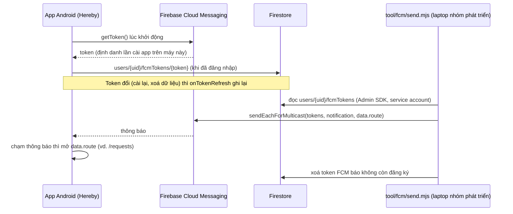

# FCM trong Hereby: token, nơi lưu, cách gửi

Tài liệu trả lời các câu thầy hỏi khi chấm Lab 3: FCM token là gì, ở đâu cấp, client có lưu không, làm sao gửi được tin, code gửi nằm ở đâu, client dùng ra sao.

## Sơ đồ



## Từng câu hỏi

**FCM token là gì?** Một chuỗi dài do Firebase cấp cho **một lần cài app trên một máy**, không phải cho người dùng. Một người có hai điện thoại thì có hai token. Cài lại app hay xoá dữ liệu app thì token đổi.

**Ở đâu cấp?** Thư viện `firebase_messaging` trong app gọi máy chủ FCM của Google lúc app chạy (`FirebaseMessaging.getToken()` trong `mobile/lib/firebase/messaging_service.dart`). App không tự sinh token.

**Client có lưu không?** Bản thân SDK giữ token trên máy. Hereby còn lưu thêm một bản lên Firestore để phía gửi biết gửi tới đâu:

- `mobile/lib/firebase/fcm_token_sync.dart`: khi có người đăng nhập trên Android, ghi token vào `users/{uid}/fcmTokens/{token}`, và ghi lại mỗi khi nhận `onTokenRefresh`.
- `packages/core/lib/services/fcm_token_repository.dart`: lớp ghi Firestore.
- Security Rules (`firebase/firestore.rules`, khối `fcmTokens`): chỉ chủ tài khoản đọc, ghi token của mình. Id tài liệu phải bằng token, chỉ có ba trường `token`, `platform`, `updatedAt`. Giáo vụ và admin cũng không đọc được token của người khác. Có 12 ca test trong `firebase/tests/rules.test.mjs`.

**Làm sao gửi được tin? Code nằm chỗ nào ở "server"?** Hereby không có máy chủ riêng (đề Final), nên phần gửi là script Node `tool/fcm/send.mjs`, chạy trên máy nhóm phát triển bằng Firebase Admin SDK:

1. Tìm uid theo email người nhận (Firebase Auth).
2. Đọc mọi token ở `users/{uid}/fcmTokens`.
3. Gọi FCM HTTP v1 (`sendEachForMulticast`) với `notification` (tiêu đề, nội dung) và `data.route`.
4. Token nào FCM báo không còn đăng ký thì xoá khỏi Firestore.

Admin SDK đăng nhập bằng **service account** (file JSON tải ở Firebase console → Project settings → Service accounts). File này là bí mật, bỏ qua Security Rules, nên chỉ nằm trên máy người gửi và đã được chặn trong `.gitignore`. Nếu project lên gói Blaze, cùng đoạn code này đặt vào Cloud Functions là gửi tự động được, ví dụ khi giáo vụ duyệt lớp.

```bash
cd tool/fcm && npm ci
export GOOGLE_APPLICATION_CREDENTIALS=/duong/dan/service-account.json
node send.mjs --to quanm@fe.edu.vn --dry-run          # xem máy nào sẽ nhận
node send.mjs --to quanm@fe.edu.vn --title "Có yêu cầu sửa mới" --body "SE190101 báo sai buổi 03/11" --route /requests
```

Gửi thử bằng Firebase console (Messaging → New campaign → Send test message) cũng được: dán token hiện ở Khu demo của app.

**Client dùng ra sao?** Trong `messaging_service.dart`:

| Trạng thái app | Cách nhận | Xử lý |
|---|---|---|
| Đang mở | `FirebaseMessaging.onMessage` | Hiện thông báo cục bộ (kênh `quick_attend`), lưu vào hộp tin ở Khu demo |
| Chạy nền | Android tự hiện thông báo; chạm thì có `onMessageOpenedApp` | Mở `data.route` |
| Đã tắt | `getInitialMessage()` lúc mở lại | Mở `data.route` |

Android 13 trở lên phải hỏi quyền `POST_NOTIFICATIONS`: nút **Cho phép** ở Khu demo gọi `requestPermission()`. Test ARTEMIS TC-15 đi đúng luồng này.

## Giới hạn

- Chỉ Android lưu token. Cổng sinh viên trên web cần VAPID key và phải hỏi quyền trình duyệt trước, bản Windows không có FCM.
- Đăng xuất xoá token của máy khỏi tài khoản trước khi rời phiên (`AccountViewModel.signOut`), để người dùng sau trên cùng máy không nhận thông báo của tài khoản cũ. Mất mạng lúc đăng xuất thì bản ghi còn lại; lần gửi sau vẫn tới máy đó cho tới khi người dùng mới đăng nhập.
