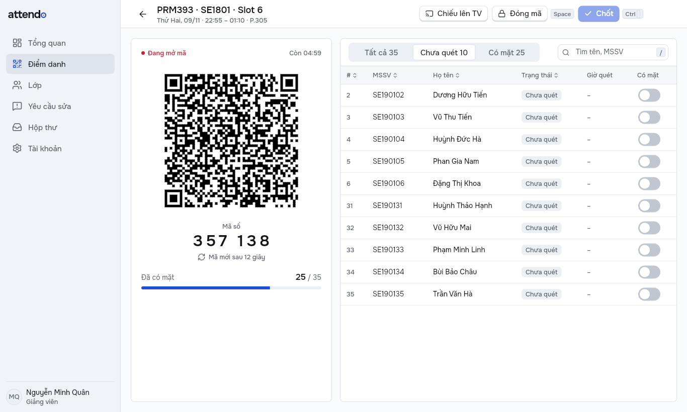
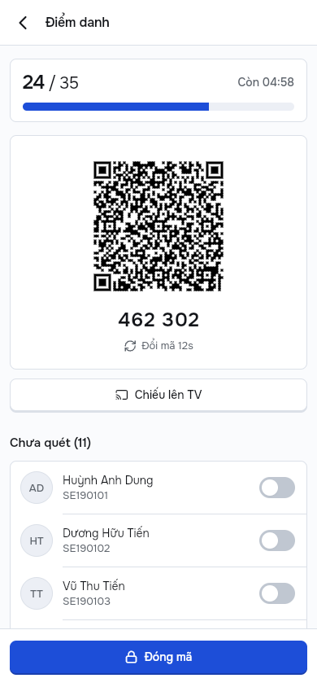
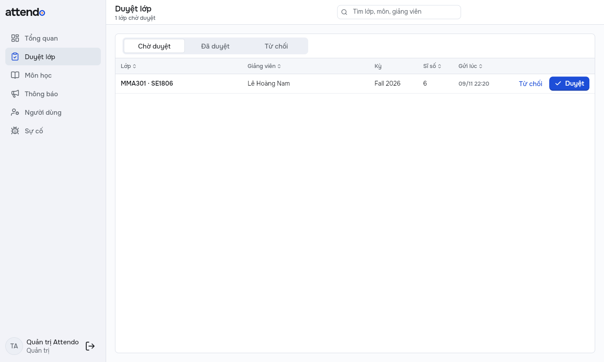
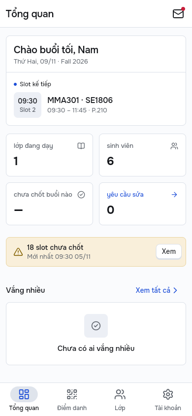
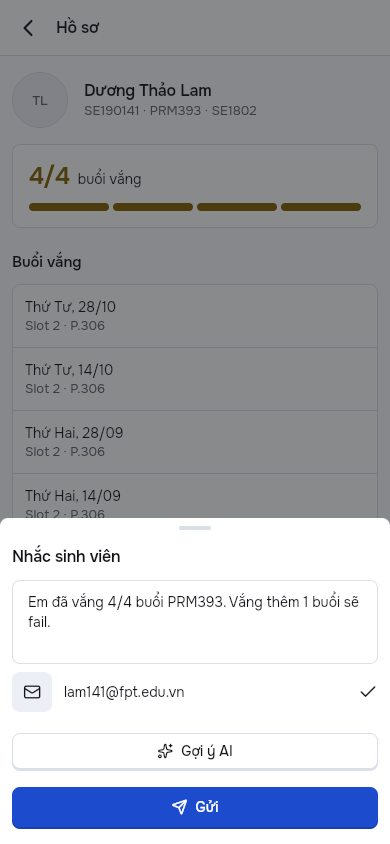

# 1. Thông tin nộp bài

| Mục | Nội dung |
|---|---|
| Sinh viên | Trần Ngọc Thiên · SE190533 |
| Repo | https://github.com/thiengthb/PRM393_Lab03_SE190533 · nhánh `final-system` (tên repo khi nộp: quyết định 003) |
| Bản cài | GitHub Release `demo`: APK giảng viên, bản Windows, extension |
| Web sinh viên | https://attendo-app-2611.web.app |
| Web admin | https://attendo-app-2611-admin.web.app |
| Màn chiếu TV, FAP giả lập | `attendo-app-2611-tv.web.app`, `attendo-app-2611-fap.web.app` |
| Slide | https://thiengthb.github.io/PRM393_Lab03_SE190533/ (bộ Final) |
| Video | _(dán link sau khi quay)_ |
| Firebase project | `attendo-app-2611`, gói Spark |
| Báo cáo Lab 3 | `report/lab3/report.md` (phần Firebase từng dịch vụ không nhắc lại ở đây) |

Mọi câu "chạy được" có nguồn đi kèm: ảnh trong `evidence/`, tài liệu trong `docs/`, hoặc lần chạy CI. Số nào chưa đo thì ghi **chưa đo**, không ước lượng.

# 2. Bài toán và người dùng

**Bối cảnh.** Ở FPTU, giảng viên điểm danh trên FAP bằng cách gọi tên rồi tick từng em. Một lớp 35 em mất vài phút đầu giờ; dạy 3 đến 4 slot mỗi ngày thì dễ quên chốt, mà quên chốt là bị nhắc và trừ lương. Sinh viên chỉ biết mình vắng bao nhiêu khi tự mở FAP, nên thường phát hiện muộn, lúc gần bị cấm thi. Khi bị ghi vắng nhầm, sinh viên phải nhắn riêng cho thầy và không có dấu vết.

**Ba nỗi đau** (lấy từ persona và user flow của Lab 2):

| # | Nỗi đau | Attendo giải quyết bằng |
|---|---|---|
| 1 | Điểm danh tốn thời gian đầu giờ, dễ quên chốt | Mã QR và mã 6 số đổi mỗi 12 giây, sinh viên tự quét; slot quá giờ chưa chốt hiện cảnh báo và nút Chốt ngay |
| 2 | Không thấy sớm em nào sắp vắng quá ngưỡng | Khối Vắng nhiều ở Tổng quan, nhắc từng em, có Gợi ý AI |
| 3 | Ghi vắng nhầm không có kênh sửa | Sinh viên báo sai trên web, giảng viên duyệt hoặc từ chối, cả hai thấy ngay |

**Bốn actor:**

| Actor | Dùng gì | Làm gì |
|---|---|---|
| Giảng viên | App Android, app Windows, extension trên FAP | Nhập lớp, mở phiên, chốt, duyệt báo sai, nhắc sinh viên, điền FAP |
| Sinh viên | Web sinh viên (điện thoại hoặc laptop) | Quét hoặc gõ mã, xem chuyên cần, báo sai |
| Quản trị (Admin) | Web admin | Duyệt lớp, quản lý môn học, đăng thông báo, cấp vai trò, xem sự cố |
| Nhóm phát triển | Firebase console | Analytics, Crashlytics, Remote Config, gửi FCM thử |

Phạm vi web theo quyết định 002 (thien chọn 09/11): một web riêng cho admin, một web riêng cho sinh viên, giảng viên dùng app Android và Windows; thêm trang chiếu QR lên TV, trang FAP giả và extension để chứng minh luồng điền FAP.

# 3. Thay đổi từ Lab 3

Đề Final yêu cầu hoàn thiện mọi luồng Lab 2 và yêu cầu Lab 3 trước khi thêm phần mới. Khoảng trống được soát ngày 02/11 ở `docs/gap-review.md`; bảng dưới là trạng thái lúc nộp.

| Mã | Đề Final yêu cầu | Lab 3 có gì | Đã làm |
|---|---|---|---|
| G-01 | `packages/core/`, `mobile/`, `web/` dùng chung một gói | Một project ở gốc repo | Tách monorepo: model, service Firestore, theme, widget vào `packages/core` |
| G-02 | Web admin 4 màn + form thông báo, trên Hosting | Chưa có | `web/`, deploy ở `attendo-app-2611-admin.web.app` (mục 6) |
| G-03 | Vai trò ở `users/{uid}.role`, chỉ Admin đổi | Chỉ có giảng viên, sinh viên | Thêm `staff`, `admin`, `user`; Rules chặn tự đổi vai trò |
| G-04 | Luồng liên vai trò có cả hai client | Báo sai (sinh viên ↔ giảng viên) | Thêm duyệt lớp giảng viên → Quản trị trên web admin (mục 7); báo sai thành luồng thứ hai |
| G-05 | Hộp thư cho thông báo | Chỉ có thông báo FCM lưu trên máy | Hộp thư gộp `announcements` và `users/{uid}/inbox`, nút thư có chấm đỏ |
| G-06 | Rules có test Emulator theo vai trò × collection | Không có test | `firebase/tests/rules.test.mjs`, 196 ca (mục 5) |
| G-07 | Tính năng AI mức 2 | Chưa có | Gợi ý lời nhắc (mục 8) |
| G-08 | App Check trên Firestore và AI Logic | Chưa có | `activateAppCheck()` ở app và web admin; debug token cho APK demo (quyết định 004) |
| G-09 | PDF lưu và chia sẻ trên máy, metadata ở Firestore; Cloud Storage ngoài phạm vi | Tải lên Storage | Lưu trên máy + hộp chia sẻ + `reports`; bản lưu đám mây dùng Cloudinary |
| G-10 | Remote Config và Analytics ở cả hai client | Chỉ app | Service chuyển vào core; web admin đọc `dashboard_top_subjects` và ghi sự kiện riêng |

**Phát hiện review của Lab 3 đã đóng:** CR-01 đến CR-07, 6 nhận có commit sửa, 1 bác có lý do (CR-06), chi tiết ở `docs/code-review.md`. Quan trọng nhất là CR-01: sinh viên đọc được `qrToken` của slot nên điểm danh từ xa được; Rules mới cấm sinh viên đọc `slots`.

**Đổi khác ngoài phạm vi đề, do sinh viên chọn:** tên Attendo và Firebase project mới (quyết định 001); app Windows cho giảng viên, màn chiếu TV, trang FAP giả và extension điền FAP (quyết định 002). Các phần này không tính điểm theo luật "Scope guard" của đề; chúng phục vụ luồng WF-01 đã có từ Lab 2.

# 4. Kiến trúc hệ thống

| Thành phần | Chạy ở đâu | Dùng Firebase gì |
|---|---|---|
| App giảng viên | Android, Windows | Auth, Firestore, Remote Config, Analytics, Crashlytics, FCM (Android), AI Logic, App Check |
| Web sinh viên | Hosting `attendo-app-2611` | Auth, Firestore, Analytics |
| Web admin | Hosting `attendo-app-2611-admin` | Auth, Firestore (aggregation), Remote Config, Analytics |
| Màn chiếu TV, FAP giả lập | Hosting `-tv`, `-fap` | TV đọc mã qua khoá trong link; FAP giả không dùng Firebase |
| Extension Chrome/Edge | Trình duyệt giảng viên | Auth, Firestore (đọc bản đã chốt), điền vào trang FAP |
| Lưu PDF | Cloudinary | Firestore `reports` giữ metadata |

**Không có server riêng** (gói Spark, không Cloud Functions). Mọi logic nghiệp vụ chạy ở client; Security Rules quyết định client được ghi gì. App Check bắt buộc với AI Logic (Firebase tự bật từ 02/11, quyết định 004); với Firestore, App Check mới gắn token, chưa bật Enforce (APK tự cài và bản debug chưa có token hợp lệ), nên ở Firestore chỉ Security Rules chặn. Hệ quả được chấp nhận ở mục 12.

**Monorepo một lõi.** `packages/core` chứa model, service Firestore, theme, widget dùng chung; `mobile/` dựng app giảng viên (Android, Windows) và web sinh viên (`PORTAL=student`); `web/` là web admin; `extension/` là extension Chrome/Edge (React, TypeScript); `fap-mock/` là FAP giả lập; `firebase/` chứa Rules, chỉ mục và bộ test Rules.

**MVVM với Riverpod 3.** View → ViewModel → Service → SDK, phụ thuộc chỉ đi xuống. Phần Final thêm 9 ViewModel (bảng ở `docs/architecture.md`): `InboxViewModel`, AI trong `StudentProfileViewModel`, kiểm mã môn trong `ImportViewModel`, và 6 ViewModel của web admin.

**Một ViewModel, nhiều View** (D-T-01). Mỗi bản chạy chọn bố cục theo nền tảng trước, độ rộng sau: Android luôn kiểu điện thoại, Windows và web admin luôn kiểu laptop, web sinh viên theo độ rộng cửa sổ (từ 900 px là laptop). Sáu màn của giảng viên có View laptop riêng (bảng, khung chi tiết bên phải, phím tắt Ctrl+D, Space, Ctrl+Enter, Esc) nhưng đọc cùng ViewModel với bản điện thoại.

{width=62%} {width=24%}

## Bốn workflow lõi

| Mã | Workflow | Trigger | Các bước chính | Rẽ nhánh | Kết quả |
|---|---|---|---|---|---|
| WF-01 | Điểm danh một buổi tới FAP | Tới giờ slot | Mở phiên → sinh viên quét QR hoặc gõ mã → đóng mã → bật tay em quên quét → chốt → extension điền FAP | Hai máy giảng viên cùng mở: một máy giữ quyền đổi mã (LOI-05); mất mạng: lưu trên máy, tự gửi lại; FAP khác slot: extension từ chối | Slot đã chốt, FAP được điền đúng danh sách |
| WF-02 | Báo sai | Sinh viên thấy buổi bị ghi vắng nhầm | Sinh viên chọn lý do, gửi → giảng viên duyệt hoặc từ chối | Từ chối phải có lý do; duyệt rồi vẫn hoàn tác được | Buổi đó đổi thành có mặt, hoặc ghi "Bị từ chối: lý do" |
| WF-03 | Duyệt lớp liên vai trò | Giảng viên nhập file lớp | Lớp ở trạng thái chờ → Quản trị duyệt trên web admin → app đổi ngay, có tin hộp thư | Từ chối kèm lý do → giảng viên nhập lại; mã môn ngoài danh mục: web cảnh báo | Lớp được mở mã điểm danh |
| WF-04 | Nhắc sinh viên vắng nhiều | Em chạm hoặc sắp chạm ngưỡng vắng | Tổng quan → Vắng nhiều → hồ sơ → Nhắc nhở → (Gợi ý AI) → sửa → Gửi | AI lỗi hoặc tắt bằng Remote Config: dùng câu mẫu | Lời nhắc được gửi và ghi lại |

**Máy trạng thái** (Rules kiểm từng bước chuyển, `docs/data-model.md`):

| Thực thể | Trạng thái | Ai chuyển |
|---|---|---|
| Slot | chưa mở → đang mở mã → đã đóng mã → đã chốt (sửa được sau khi chốt) | Giảng viên chủ slot; mở mã chỉ khi lớp đã duyệt |
| Lớp | (chưa có) → chờ duyệt → đã duyệt / bị từ chối → chờ duyệt (nhập lại) | Giảng viên tạo; Admin duyệt trên web (Rules cho cả staff) |
| Báo sai | chờ → đã duyệt / bị từ chối; đã duyệt → chờ (hoàn tác) | Sinh viên tạo; giảng viên của lớp duyệt |

# 5. Mô hình dữ liệu và Security Rules

Năm vai trò ở `users/{uid}.role`: `student`, `lecturer`, `staff` (giáo vụ), `admin`, `user` (tài khoản mới ở web admin, chưa có quyền). Admin đầu tiên đặt trên console; sau đó chỉ Admin đổi vai trò, không ai đổi được của chính mình.

| Collection | Ai tạo | Ai đọc | Điểm đáng chú ý |
|---|---|---|---|
| `classes`, `students`, `slots` | Giảng viên chủ lớp | Chủ lớp, staff, admin | Sinh viên **không đọc** `slots` vì có `qrToken` (CR-01) |
| `slots/{id}/attendance/{mssv}` | Chủ slot; sinh viên khi mã đúng, còn hạn, có tên trong lớp | Chủ slot; sinh viên đọc bản của mình | Mã vừa thay còn nhận thêm một chu kỳ |
| `requests` | Sinh viên, chỉ đúng MSSV của mình | Sinh viên chủ, giảng viên của lớp | Chỉ sửa các trường duyệt |
| `subjects`, `announcements` | Staff, admin | Người đã đăng nhập (thông báo: đúng đối tượng) | Lưu trữ thay vì xoá |
| `users/{uid}/inbox`, `fcmTokens` | Staff (inbox); chủ tài khoản (token) | Chủ tài khoản | Admin cũng không đọc token người khác |
| `crashReports` | Mọi người, chỉ cho chính mình | Admin | Web admin hiện ở màn Sự cố |

Bảng đủ 13 collection, kiểu trường và chuyển trạng thái: `docs/data-model.md`.

**Bằng chứng:** bộ test Rules trên Firebase Emulator: collection nào cũng có ca Allowed và ca Denied; vai trò không có quyền với một collection thì chỉ có ca Denied (ví dụ sinh viên với `slots`), riêng `studentCodes` chỉ có ca cho sinh viên và tài khoản mới: **196 ca đạt, 0 lỗi** (Emulator 10/11, gồm 13 ca mới cho CR-15 và CR-25; CI xanh trên PR #29, run 42787095197); bảng từng ca ở `evidence/rules/rules-test-results.md`. Ảnh Rules trên console: `evidence/firestore/02-rules.png`.

# 6. Web admin

| Đề yêu cầu | Màn | Làm gì | Ai |
|---|---|---|---|
| Sign-in | Đăng nhập | Google; vai trò sai bị từ chối ở màn `/denied` với câu rõ ràng | Mọi người |
| Dashboard | Tổng quan | Số lớp, lớp chờ duyệt, sinh viên, tỉ lệ có mặt (aggregation `count`, `sum`), biểu đồ theo môn; số môn lấy từ Remote Config `dashboard_top_subjects` | Admin |
| Review queue | Duyệt lớp | Hàng đợi, khung chi tiết danh sách sinh viên, Duyệt / Từ chối có lý do, cảnh báo mã môn lạ | Admin |
| Management | Môn học | Tìm, thêm, sửa, lưu trữ, khôi phục; chặn trùng mã và sai định dạng | Admin |
| Announcement form | Thông báo | Đăng theo đối tượng (tất cả, giảng viên, sinh viên), lưu trữ; hiện ngay trong hộp thư app | Admin |
| Thêm | Người dùng | Cấp vai trò; không đổi được chính mình | Admin |
| Thêm | Sự cố | Đọc `crashReports` do app ghi khi crash hoặc non-fatal | Admin |

**Vai trò được vào:** bản nộp chỉ mở web admin cho Quản trị (thien chọn 10/11). Vai trò `staff` (giáo vụ) đã có quyền trong Security Rules và trong bộ test Rules, nhưng màn đăng nhập web từ chối staff (`webAdminRoles` trong `web/lib/router.dart`), giống mọi vai trò khác không phải Admin. Mở cho giáo vụ chỉ cần thêm `UserRole.staff` vào tập này.

Mọi màn có ba trạng thái đang tải, rỗng (`EmptyState`, ví dụ "Đã xử lý hết" ở Duyệt lớp) và lỗi có nút Thử lại (`ErrorState`). Web admin dùng cùng token và component của `packages/core` với app, bố cục màn rộng (thanh bên, bảng, khung chi tiết bên phải) theo `flutter-handoff.md` của Lab 2.

**Bằng chứng:** E2E W30 đến W34 (tổng quan, thông báo tới hộp thư sinh viên, môn học, người dùng và chặn người lạ, sự cố) đạt trong lần chạy E2E 42644368921. Trên Firebase thật: LOI-14 (Tổng quan báo lỗi vì sai thứ tự trường chỉ mục) đã sửa ở `ff734c2` và Claude kiểm lại 09/11 15:35; màn Sự cố hiện Test crash ngay sau khi crash (`evidence/crashlytics/02-web-admin-test-crash.png`). Checklist W-01 đến W-19 trong `docs/test-report.md` mục 4: **chưa chụp đủ ảnh từng dòng**.

## Giao diện và thương hiệu

Từ 06/11 app đổi tên thành **Attendo**, logo chữ "attend" kèm chữ o là vòng tròn có chấm giữa (chấm màu cam FPT, D-T-10). Màu mặc định **Bản vẽ** (cobalt #1D4ED8, D-T-09) dùng chung cho app, web, extension, icon và slide; có chế độ tối và khung Chọn màu trong Tài khoản. Token nằm ở `packages/core/lib/theme/tokens.dart`; `tool/tokens/gen_css.mjs` sinh CSS cho các trang web tĩnh. Phông Onest, bo góc 8, nút có gờ đáy 2 px lún xuống khi bấm, thẻ phẳng có viền.

Mỗi khác biệt so với thiết kế Lab 2 có mã và lý do trong `docs/design-traceability.md` (D-L3-xx cho Lab 3, D-F-xx cho phần Final, D-T-xx cho đợt đổi giao diện).

# 7. Luồng liên vai trò

Luồng bắt buộc là WF-03 Duyệt lớp; WF-02 Báo sai là luồng thứ hai. Lý do có bước duyệt lớp: giảng viên tự đăng ký được, nên một tài khoản bất kỳ không được mở mã điểm danh cho tới khi Quản trị xác nhận lớp trên web admin (chữ trên app vẫn là "Chờ giáo vụ duyệt", vì vai trò giáo vụ có sẵn trong Rules). Chi tiết từng bước (màn, ghi Firestore, luật cho phép, client kia thấy gì) ở `docs/cross-role-flow.md`.

| # | Ai, client | Thao tác | Ghi Firestore | Client kia thấy |
|---|---|---|---|---|
| 1 | Giảng viên, Android | Nhập lớp | `classes/{id}` `status=pending` | Web Duyệt lớp có thẻ mới ngay |
| 2 | Quản trị, web admin | Duyệt (hoặc Từ chối + lý do) | Batch: `status=approved` + `users/{uid}/inbox` | App bỏ chữ "Chờ giáo vụ duyệt", slot hiện, chấm đỏ trên nút thư |
| 3 | Giảng viên, Android | Mở phiên | `slots/{id}` `qrOpen=true` | Trước khi duyệt, Rules từ chối ghi này |

{width=62%} {width=24%}

**Đã chạy trên Firebase thật:** test tay T3 ngày 09/11 (LOI-26 ghi lần đầu bấm nhầm bản app cũ; dùng đúng app thì đạt). E2E W20 và W61 chạy luồng này trên Emulator mỗi lần CI E2E.

**Thời gian từ lúc Quản trị bấm Duyệt tới khi app đổi, 3 lần:** **chưa đo**. Sẽ đo bằng cách quay cả hai màn trong cùng khung khi quay video và đếm khung hình; bảng điền ở `docs/cross-role-flow.md`.

# 8. Tính năng AI mức 2: Gợi ý lời nhắc

Ở màn Nhắc sinh viên (WF-04), nút **Gợi ý AI** gọi Gemini qua Firebase AI Logic, nhận JSON đúng schema `{tone, message, next_step}` rồi điền vào ô soạn. Giảng viên đọc, sửa rồi mới gửi; ô soạn gắn nhãn "AI gợi ý · kiểm tra trước khi gửi".

| Yêu cầu | Cách làm | Mã |
|---|---|---|
| Structured output | `responseSchema` JSON; parse chặt, sai dạng thì báo lỗi, không điền nửa vời | `mobile/lib/firebase/ai_service.dart` |
| Người dùng xác nhận | AI chỉ điền ô soạn; gửi vẫn là thao tác của giảng viên | `student_screens.dart` |
| Không gửi dữ liệu cá nhân | `ReminderInput` chỉ có mã môn và 4 con số, kiểu dữ liệu không có chỗ cho tên, email, MSSV; có test prompt | `models.dart`, `final_logic_test.dart` |
| Điều khiển từ xa | `ai_model`, `ai_reminder_prompt`, `ai_reminder_enabled` trên Remote Config; tắt thì nút biến mất | `config_service.dart` |
| Lỗi không chặn luồng | Quota, mạng, timeout 20 giây: giữ câu mẫu, báo lý do, nút Gửi vẫn dùng được | `requestAiDraft()` |
| Đo được | `ai_request`, `ai_result_accepted` (có cờ đã sửa), `ai_error` | `analytics_service.dart` |
| App Check | Bắt buộc cho AI Logic từ 02/11/2026; APK demo dùng một debug token chung | Quyết định 004 |

**Đã chạy thật:** 09/11 11:56, sau khi sửa App Check (LOI-15) và giới hạn độ dài trong prompt (LOI-23), ô soạn trên điện thoại hiện lời nhắc do Gemini viết (`docs/demo/loi.md`).

{width=26%}

**Ba cặp đầu vào, đầu ra nguyên văn:** **chưa ghi**. Bảng chờ điền ở `docs/ai-feature.md` (PRM393 2/4, PRM393 3/4, MMA301 5/4).

# 9. Kiểm thử

| Loại | Công cụ | Kết quả | Nguồn |
|---|---|---|---|
| Unit và widget | `flutter test` | 59 test app + 11 test web admin đạt | CI run 42742315932, commit `63d8cf9` |
| Phân tích tĩnh | `flutter analyze` | 0 lỗi | như trên |
| Security Rules | Firebase Emulator | 196 ca đạt | Emulator 10/11 và CI run 42787095197 trên PR #29 (mục 5); `evidence/rules/rules-test-results.md` |
| E2E web | Playwright + Emulator, 4 web dựng thật | 33/33 đạt | workflow E2E builds, run 42644368921 |
| Extension | Vitest, ESLint, typecheck, build | Đạt | job CI "Extension, FAP giả lập, script FCM" |
| Test tay trên Firebase thật | 6 ca T1 đến T6 (`docs/demo/TEST-TAY.md`) | T1, T2, T3, T5, T6 đạt, có ảnh. Sinh viên chạy T1, T3, T5, T6 (09/11 tối); Claude chạy T1, T2, T4 trên máy của sinh viên (09/11, `docs/ai-log.md` AI-13) | `evidence/extension`, `evidence/fcm`, `evidence/crashlytics` |
| ARTEMIS trên điện thoại thật | Mọi luồng Lab 2, bước mobile của WF-03, AI; 3 lần mỗi ca | **chưa chạy đủ** | Báo cáo Lab 3 mục 8.1 |
| Web admin checklist | W-01 đến W-19, mỗi dòng một ảnh | E2E W30 đến W34 đạt; **ảnh từng dòng chưa chụp đủ** | `docs/test-report.md` mục 4 |
| Luồng liên vai trò trên bản deploy | WF-03, 3 lần, có đo thời gian | Chạy đạt 1 lần (T3, 09/11); **3 lần đo chưa làm** | `docs/cross-role-flow.md` |

E2E web phủ cả bốn workflow: WF-01 (W03, W04, W48, W49, W50, W60, W70), WF-02 (W11, W12, W71), WF-03 (W20, W61), WF-04 (W05, W06), cùng web admin (W30 đến W34) và bố cục laptop (W46). Mỗi ca nạp lại dữ liệu mẫu trước khi chạy nên không phụ thuộc thứ tự.

**Lỗi tìm được khi tự test và test tay:** 26 lỗi ghi ở `docs/demo/loi.md`, mỗi lỗi có nguyên nhân và trạng thái. Ví dụ đáng kể: LOI-05 (hai máy giảng viên cùng đổi mã làm sinh viên nhận "Mã đã hết hạn"), LOI-13 (Hosting cho trình duyệt giữ JS cũ 1 giờ), LOI-14 (chỉ mục aggregation sai thứ tự trường), LOI-15 (AI Logic bắt buộc App Check).

# 10. Review mã bằng AI

| Lượt | Công cụ | Phạm vi | Kết quả |
|---|---|---|---|
| 1 (30/10) | Claude | Mã Lab 3 | CR-01 đến CR-07 |
| 3 (02/11 trở đi) | Claude | Mã Final | CR-08 đến CR-14 |
| 2 (10/11) | CodeRabbit trên PR #28 | 38 file service, ViewModel, Rules | CR-15 đến CR-30: 16 phát hiện, 14 sửa ở PR #29, 1 đã sửa trước (CR-16), 1 từ chối có số đo (CR-30) |

Lượt 1 và 3 do chính Claude viết mã rồi tự review nên không độc lập. Lượt độc lập là CodeRabbit, nhưng chỉ phủ 38 file service, ViewModel và Rules của bản Lab 3 (PR #28) cùng các bản sửa và tài liệu (PR #29 và PR #30, CR-31 đến CR-44); phần mã chỉ có ở Final (web admin, AI, tiện ích) chưa có lượt review độc lập. Phát hiện đáng kể của CodeRabbit: CR-15 (ai cũng tự khai MSSV của người khác để đọc lịch sử điểm danh, sửa bằng khoá `studentCodes/{mssv}` trong Rules), CR-26 (duyệt đơn luôn cộng một có mặt dù em đã được sửa tay), CR-27 (sửa buổi đã chốt làm buổi đó biến khỏi lịch sử sinh viên), CR-40 (mật khẩu mẫu công khai trong README mở được tài khoản Admin trên Firebase thật; nay tài khoản giáo vụ, quản trị có mật khẩu ngẫu nhiên). Các phát hiện phần Final đáng kể: CR-09 (nhãn "AI gợi ý" còn dính khi ô soạn đã về câu mẫu), CR-10 (lời nhắc dài hơn 300 ký tự bị Rules từ chối nhưng app báo sai lý do), CR-13 (Rules không kiểm định dạng `route` của tin hộp thư, app dùng thẳng để mở màn), CR-14 (bản Lab 3 cho giảng viên bất kỳ ghi vào danh sách lớp người khác). Mỗi dòng có quyết định ở `docs/code-review.md`; dòng được chấp nhận có commit sửa, dòng bị bác (như CR-12) ghi lý do.

# 11. Bài học

- **Rules là nơi chặn thật, nên phải test như code.** Bộ test Emulator bắt được CR-14 (giảng viên khác ghi được vào danh sách lớp người khác), lỗi mà mọi test giao diện đều không thấy vì app không bao giờ gửi yêu cầu đó.
- **Emulator xanh chưa có nghĩa là bản thật chạy.** LOI-13 (Hosting giữ JS cũ 1 giờ), LOI-14 (chỉ mục aggregation sai thứ tự trường), LOI-15 (AI Logic bắt buộc App Check) chỉ lộ ra trên Firebase thật. Từ 09/11 mỗi đợt sửa đều chạy lại trên project thật trước khi báo xong.
- **Luồng liên vai trò cần một bước chờ thật.** Bước "Chờ giáo vụ duyệt" vừa là yêu cầu của đề vừa vá giới hạn tự khai vai trò khi không có server.
- **Ghi bằng chứng ngay khi chạy.** Dữ liệu demo được nạp lại nhiều lần; ảnh không chụp lúc chạy thì không dựng lại được, và đề coi bằng chứng dựng lại là gian lận.
- **AI phải có đường lùi.** Lỗi quota, mạng, App Check xảy ra thật trong tuần làm bài; vì nút Gửi luôn dùng được với câu mẫu nên luồng nhắc sinh viên chưa lần nào bị chặn.

# 12. Quyết định, giới hạn và hướng tiếp

**Quyết định khó sửa** (`docs/decisions/`, thien chọn):

| # | Quyết định | Chọn |
|---|---|---|
| 001 | Firebase project mới `attendo-app-2611`, mã app `app.attendo` | Bỏ hẳn tên cũ và mã số khỏi sản phẩm |
| 002 | Web phục vụ ai | Web admin riêng, web sinh viên riêng, giảng viên dùng app; thêm TV, FAP giả, extension |
| 003 | Tên repo khi nộp | Tên sản phẩm, mã số ghi trong README và báo cáo |
| 004 | App Check cho AI | Một debug token chung trong APK demo, xoá sau khi chấm |

**Giới hạn đã biết:**

- **Tự khai vai trò và MSSV.** Không có Cloud Functions để xác minh với nhà trường. Giảm rủi ro bằng bước duyệt lớp (WF-03) và Rules kiểm MSSV có trong danh sách lớp khi quét.
- **Thông báo đẩy không tự gửi từ hệ thống.** Không có server để gửi FCM theo sự kiện; hộp thư đọc Firestore thời gian thực nên tin vẫn tới khi app mở. FCM gửi từ console hoặc `tool/fcm/send.mjs`.
- **Debug token App Check nằm trong APK demo:** phải xoá sau khi chấm (quyết định 004).
- **App Windows không có đăng nhập Google** (thư viện Google của Flutter chưa hỗ trợ Windows).

**Hướng tiếp:** Cloud Functions để gửi FCM theo sự kiện (lớp được duyệt, báo sai được xử lý) và xác minh email trường; phát hành qua Play Store để dùng Play Integrity thay debug token; extension đọc trực tiếp FAP thật sau khi được nhà trường cho phép.

# 13. Công cụ AI

| Công cụ | Dùng làm gì |
|---|---|
| Claude (Claude Code) | Viết phần lớn mã, test, tài liệu, báo cáo; tự test trên Firebase thật qua điện thoại và trình duyệt |
| Gemini (Firebase AI Logic) | Tính năng Gợi ý lời nhắc |
| Google ARTEMIS | Test E2E trên điện thoại thật |
| CodeRabbit (GitHub app) | Review lượt 2 trên PR #28 |

Mỗi phiên làm với AI có một dòng trong `docs/ai-log.md` (ai yêu cầu, AI làm gì, sinh viên kiểm gì, quyết định gì). Sinh viên tự chọn mọi quyết định sản phẩm (tên, màu, phạm vi web, tên repo, App Check). Sinh viên tự chạy ca test tay T1, T3, T5, T6 trên máy thật; T2, T4 (và một lượt T1) do Claude chạy trên máy của sinh viên (AI-13), sinh viên xem kết quả.
