# 1. Thông tin nộp bài

| Mục | Nội dung |
|---|---|
| Sinh viên | Trần Ngọc Thiên · SE190533 |
| Repo | https://github.com/thiengthb/PRM393_Lab03_SE190533 · nhánh `final-system` (mục 12 giải thích vì sao không ở `lib/` gốc) |
| Bản cài | GitHub Release `demo`: APK giảng viên, bản Windows, extension |
| Web sinh viên | https://attendo-app-2611.web.app |
| Slide | https://thiengthb.github.io/PRM393_Lab03_SE190533/lab3.html |
| Video | _(dán link sau khi quay)_ |
| Firebase project | `attendo-app-2611` (khớp `google-services.json`), gói Spark |
| Thiết kế Lab 2 | repo `thiengthb/prm323-lab2-SE190533` (persona, user flow, screen spec, handoff) |

Mọi câu "chạy được" trong báo cáo có nguồn đi kèm: ảnh, file trong `evidence/`, hoặc link lần chạy CI. Mục nào chưa chạy thì ghi "chưa chạy", không điền số.

# 2. Tổng quan dự án và tóm tắt Lab 2

**Bài toán.** Giảng viên FPTU dạy 3 đến 4 slot mỗi ngày phải điểm danh trên FAP; quên điểm danh là bị trừ lương, còn báo cáo chỉ có con số, không chỉ ra em nào cần giúp. Sinh viên thì ít khi tự theo dõi số buổi vắng cho tới khi gần bị cấm thi.

| Persona (Lab 2, `ux/persona.md`) | Mức | Nhu cầu chính |
|---|---|---|
| P-01 Thầy Minh Quân, dạy dày | Primary | Chốt điểm danh trong vài giây rồi dạy tiếp; biết sớm em vắng nhiều |
| P-02 Cô Thu Hà, lịch không đều | Secondary | Được nhắc đúng lúc để không quên chốt |
| P-03 Gia Huy, sinh viên | Secondary (web) | Quét mã nhanh, biết mình còn được vắng mấy buổi |

**Tiêu chí thành công Lab 2.** TC-1: từ lúc mở app tới khi chốt một slot ≤ 20 giây khi lớp đã quét xong. TC-2: cuối ngày không còn slot chưa chốt mà thầy không được nhắc. TC-3: từ Tổng quan chỉ ra em cần chú ý ≤ 10 giây. TC-4: từ thông báo nhắc tới chốt xong ≤ 3 lần chạm. TC-5: sinh viên đọc được số buổi còn được vắng ngay sau khi quét. Sự kiện Analytics `attendance_close` đo một phần TC-1: tham số `duration_sec` tính từ lúc mở mã tới lúc chốt, gồm cả thời gian chờ lớp quét (mục 7); đoạn từ mở app tới mở mã chưa đo.

**Sản phẩm.** Giảng viên mở phiên trên điện thoại, app hiện mã QR và mã 6 số đổi mỗi 12 giây; sinh viên quét mã hoặc gõ mã trên web; giảng viên đóng mã, bật tay cho em quên quét rồi chốt. Sinh viên xem chuyên cần từng môn và báo sai khi bị ghi vắng nhầm; giảng viên duyệt hoặc từ chối.

| Mã | Luồng Lab 2 | Màn |
|---|---|---|
| FL-0 | Đăng nhập, đăng ký, nhập lớp lần đầu | GV-090 đến GV-094, GV-100 |
| FL-1 | Điểm danh một slot: mở mã → sinh viên quét → đóng mã → bật tay → chốt | GV-001, GV-102 |
| FL-2 | Không quên chốt: slot quá giờ chưa chốt hiện cảnh báo và nút Chốt ngay | GV-001, GV-002 |
| FL-3 | Chăm sóc sinh viên vắng nhiều: hồ sơ, gửi lời nhắc | GV-104, GV-201, OV3 |
| FL-4 | Sinh viên quét mã hoặc gõ mã, xem chuyên cần, báo sai | SV-001, SV-002, SV-101, SV-102 |
| FL-4b | Giảng viên duyệt hoặc từ chối báo sai | GV-105 |

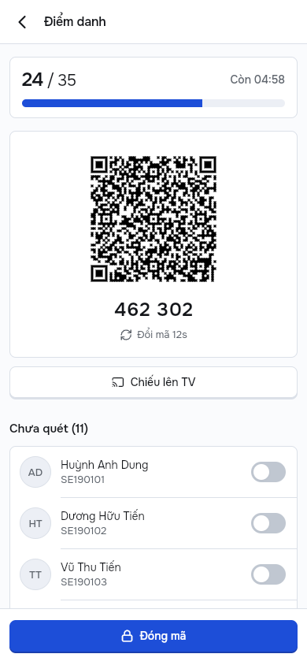{width=17%} 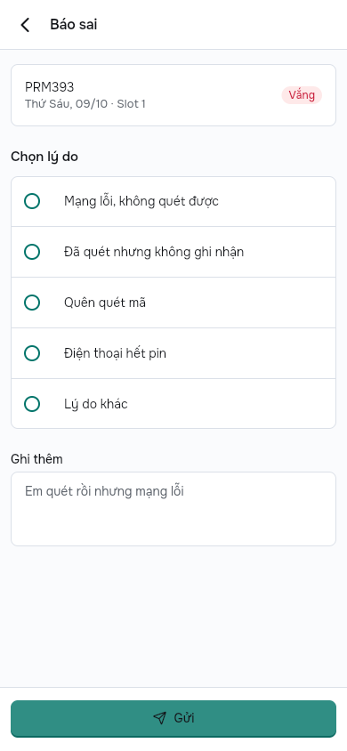{width=40%}

# 3. Truy vết thiết kế và khác biệt

`docs/design-traceability.md` nối mỗi màn, luồng và component của Lab 2 với route Flutter, widget và nguồn dữ liệu. Mọi chỗ khác thiết kế có mã và lý do. Các khác biệt lớn:

| Mã | Khác gì | Vì sao |
|---|---|---|
| D-L3-01 | Phía sinh viên chạy trên Flutter Web cùng codebase | Thiết kế Lab 2 cho sinh viên dùng web, không cài app |
| D-L3-11 | Nút 40 và 36 giữ hình, ô bấm cao 48 | Đề yêu cầu vùng chạm ≥ 48 dp |
| D-L3-13, D-L3-14 | Thêm mã 6 số và màn chiếu TV | Sinh viên ngồi xa không quét được QR trên điện thoại giảng viên |
| D-L3-18 | PDF tải lên Cloudinary thay Cloud Storage | Cloud Storage cần gói Blaze, project ở gói Spark |
| D-T-09, D-T-10 | Tên Attendo, bảng màu Bản vẽ | Đổi thương hiệu sau góp ý của thầy |
| D-T-11 | Ô "có mặt tuần này" giữ nhãn cố định | Nhãn cũ đứng cạnh dải "slot chưa chốt" đọc thành mâu thuẫn |

# 4. Kiến trúc và MVVM

MVVM với Riverpod 3. Phụ thuộc chỉ đi một chiều: View → ViewModel → Service → SDK. Màn hình không import Firebase; lọc, đếm và quyết định trạng thái nằm ở ViewModel, nên test được mà không cần thiết bị.

| Lớp | Ở đâu | Trách nhiệm |
|---|---|---|
| View | `mobile/lib/screens/` | Dựng giao diện từ state, gửi thao tác lên ViewModel |
| ViewModel | `mobile/lib/viewmodels/` (một Notifier mỗi màn) | Giữ `ViewState` (đang tải, rỗng, lỗi, có dữ liệu), gọi service, ghi Analytics |
| Service | `packages/core/lib/services/`, `mobile/lib/services/` | Interface và bản Firestore/Auth; test thay bằng bản giả qua provider |
| Firebase | `packages/core/lib/firebase/`, `mobile/lib/firebase/` | Analytics, Remote Config, App Check, Crashlytics, Messaging |

Service được tiêm qua provider (`providers.dart`), không có singleton gọi thẳng từ widget, không dùng `setState` cho state dùng chung. Luật kiến trúc kiểm bằng lệnh `grep` ghi trong `docs/code-review.md` trước mỗi lần nộp. Sơ đồ đầy đủ ở `docs/architecture.md`.

# 5. Design system trong code

| Lab 2 | Trong code |
|---|---|
| Token màu, cỡ chữ, khoảng cách, bo góc | `packages/core/lib/theme/tokens.dart` (`AppColors`, `AppSpace`, `AppRadius`, `AppPalette`) |
| Theme | `app_theme.dart` dựng `ColorScheme`, `TextTheme` từ token; màn hình đọc màu qua `Theme`, không viết mã màu cứng |
| Component | `packages/core/lib/widgets/`: `AppButton`, `AppTextField`, thẻ slot, chip trạng thái, `EmptyState`, thanh tab, snackbar |
| Extension FAP | `tool/tokens/gen_css.mjs` sinh `design/tokens/attendo.css` từ cùng token |

Đổi màu chỉ cần sửa `tokens.dart`; khung Chọn màu trong Tài khoản đổi bảng màu ngay khi chạy.

# 6. Firebase: từng dịch vụ và cách xử lý lỗi

## 6.1 Authentication

Email và mật khẩu (có xác nhận email) hoặc Google. Vai trò nằm ở `users/{uid}.role`; Security Rules đọc `request.auth.uid` rồi tra vai trò. Code: `packages/core/lib/services/auth_service.dart`, `mobile/lib/viewmodels/auth_viewmodels.dart`.

**Lỗi được xử lý:** sai mật khẩu hiện "Sai email hoặc mật khẩu"; đóng hộp chọn tài khoản Google hiện "Đã hủy đăng nhập"; tài khoản sai vai trò bị từ chối bằng câu rõ ràng.

**Bằng chứng:** đăng nhập Google trên điện thoại vào thẳng Tổng quan có dữ liệu (10/11/2026, `docs/demo/DEMO-GOOGLE.md`). Ảnh console 10/11/2026: danh sách người dùng có cả tài khoản Google và email, hai cách đăng nhập đang bật (`evidence/auth/`; địa chỉ Gmail cá nhân đã che).

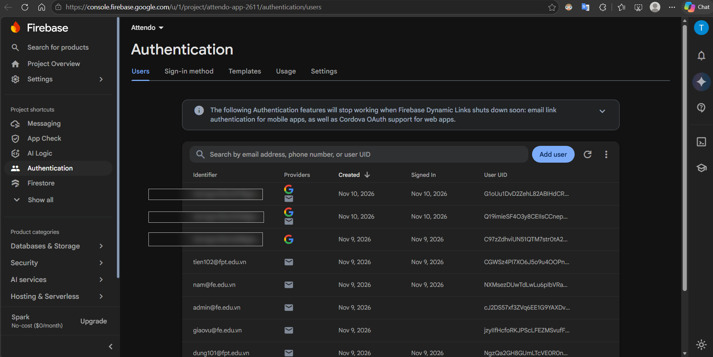{width=48%} 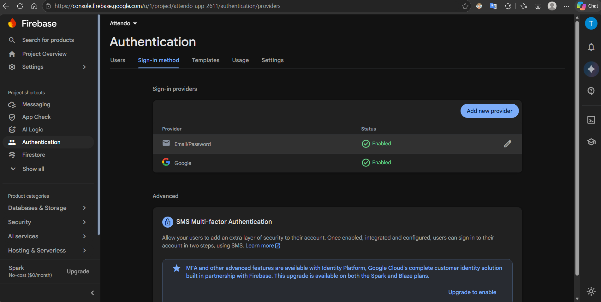{width=48%}

## 6.2 Cloud Firestore và Security Rules

Mọi dữ liệu ở Firestore, đọc theo thời gian thực: sinh viên quét xong thì số có mặt trên điện thoại giảng viên tăng ngay. Không có server riêng, nên Security Rules quyết định ai làm được gì. Luật quét mã: sinh viên chỉ ghi được bản điểm danh của chính mình khi mã đúng, còn hạn (mã vừa thay còn nhận thêm một chu kỳ) và có tên trong lớp; sinh viên không đọc được slot nên không lấy được token. Mô hình dữ liệu: `docs/data-model.md`.

**Lỗi được xử lý:** mất mạng khi chốt thì app lưu trên máy (Firestore offline), hiện dải vàng "Chưa gửi được · Đã lưu trên máy" và nút Thử lại; có mạng lại thì tự gửi. Rules từ chối thì hiện "Không có quyền truy cập".

**Bằng chứng:** bộ test Rules trên Firebase Emulator **196 ca đạt, 0 lỗi** (chạy 10/11/2026 sau các bản sửa CR-15, CR-25, có 13 ca mới; CI xanh trên PR #29, run 42787095197); bảng từng ca ở `evidence/rules/rules-test-results.md`. Ảnh console 10/11/2026: dữ liệu `classes` và Rules đang chạy (`evidence/firestore/`).

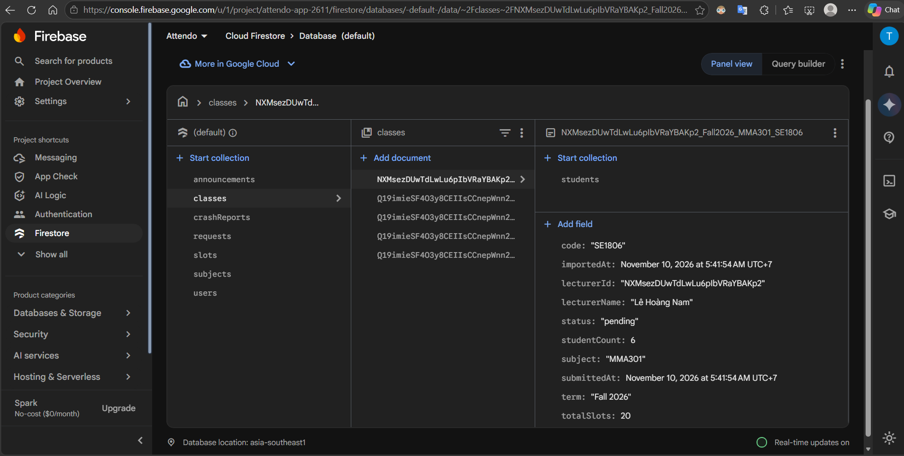{width=48%} 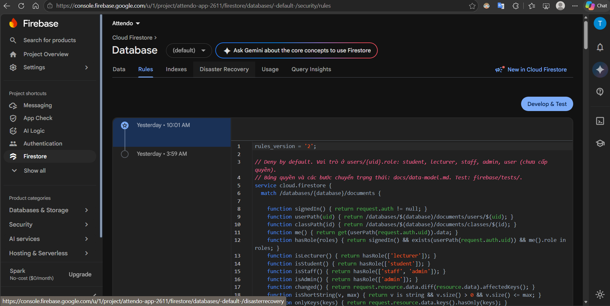{width=48%}

## 6.3 Lưu file: Cloudinary thay Cloud Storage

PDF báo cáo lớp sinh từ đúng nội dung đang xem, tải lên Cloudinary bằng preset unsigned vào thư mục riêng của từng giảng viên (`reports/<uid>/`), lưu trên máy và mở hộp chia sẻ; Firestore `reports` giữ metadata. Lý do: Cloud Storage cần gói Blaze (D-L3-18). Code: `mobile/lib/services/cloud_upload_service.dart`, test ở `mobile/test/cloud_upload_test.dart`.

**Lỗi được xử lý:** thanh tiến độ theo phần trăm; tải lên lỗi thì báo lỗi và ghi Crashlytics non-fatal (`export_report`); cờ Remote Config `report_cloud_upload` tắt bước tải lên mà không cần dựng lại app.

**Bằng chứng:** 10/11/2026 21:26, Xuất PDF trên điện thoại thật; file `PRM393-SE1801-20261110-2126` nằm đầu danh sách Assets trên Cloudinary (`evidence/storage/`).

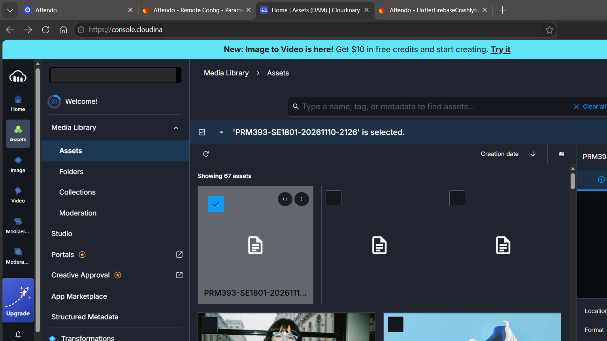{width=55%}

## 6.4 Cloud Messaging (FCM)

Token FCM là định danh của một lần cài app trên một máy, do máy chủ FCM cấp khi app gọi `getToken()` (`mobile/lib/firebase/messaging_service.dart`). App ghi token vào `users/{uid}/fcmTokens/{token}`; chạm thông báo thì app mở màn ghi trong `data.route`. Trả lời đủ các câu hỏi về token ở `docs/fcm.md`.

**Lỗi được xử lý:** người dùng chưa cho phép thông báo thì Khu demo hiện trạng thái và nút xin quyền; token đổi thì `onTokenRefresh` ghi lại.

**Bằng chứng:** nhận thông báo ở cả ba trạng thái app (đang mở, ở nền, đã tắt), điện thoại thật, 09/11/2026 (`evidence/fcm/`).

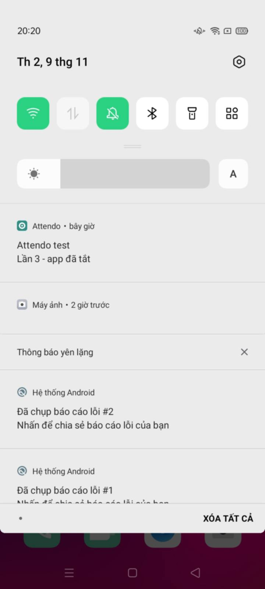{width=18%} 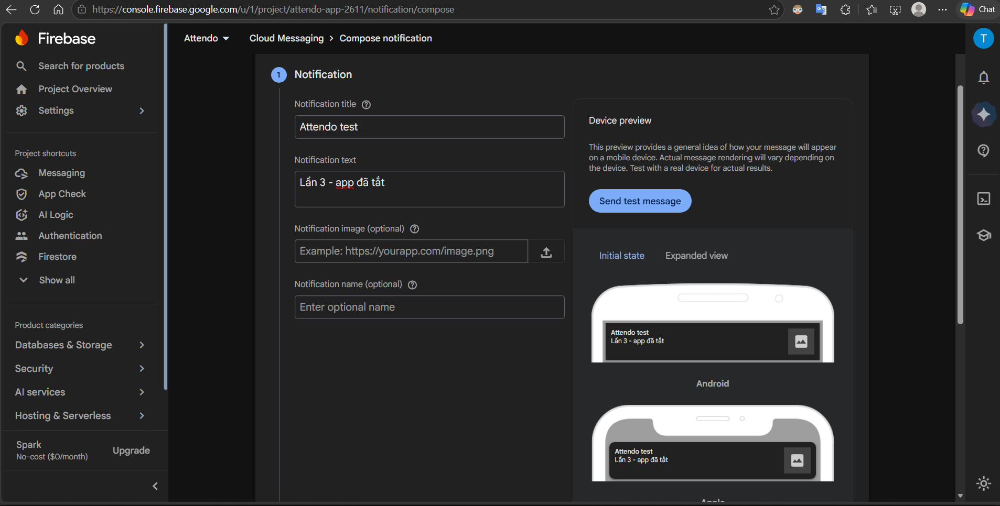{width=50%}

## 6.5 Analytics

13 sự kiện, mỗi sự kiện trả lời một câu hỏi và gắn với một bước của luồng Lab 2 (`docs/analytics-plan.md`). Sự kiện ghi ở ViewModel; lỗi khi ghi bị nuốt để không làm hỏng luồng chính. User property `role` tách số liệu giảng viên và sinh viên.

**Bằng chứng DebugView** (`evidence/analytics/`): đủ 13 trên 13 sự kiện. Điện thoại thật (10/11/2026) có 11 sự kiện: `sign_up`, `import_classes`, `logout`, `login` (kèm user property `role`), `attendance_session_open`, `attendance_close` (kèm tham số), `view_class`, `export_report`, `view_student`, `reminder_send`, `correction_review`. Web sinh viên (11/11/2026, trình duyệt Edge bật debug bằng Tag Assistant) có 2 sự kiện còn lại: `qr_scan` (gõ mã sai, `result = wrongCode`) và `correction_submit`.

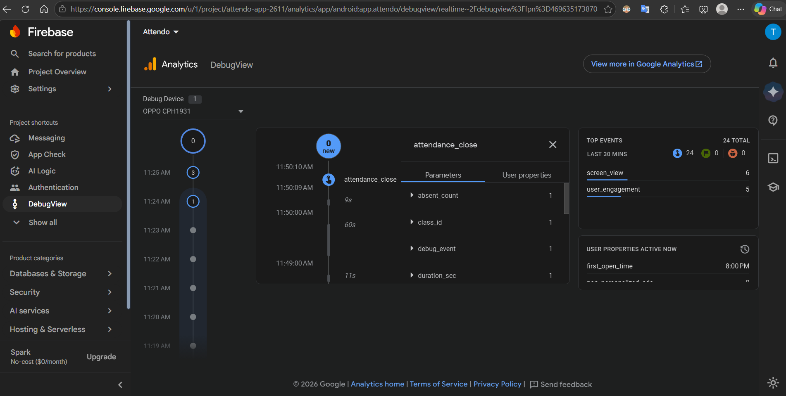{width=31%} 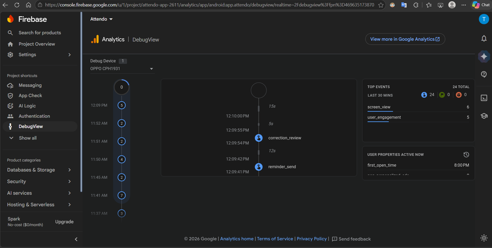{width=31%} 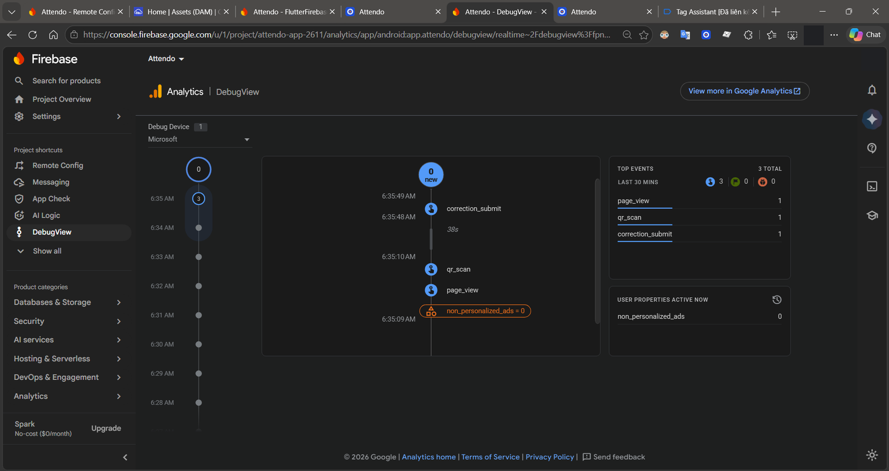{width=31%}

## 6.6 Crashlytics

Khu demo có nút Test crash và nút ghi lỗi non-fatal; khoá tuỳ chỉnh `role`, `term`, `last_error_where`. Crashlytics không có API cho client đọc, nên app ghi thêm một bản tóm tắt vào `crashReports` để web admin hiện ở màn Sự cố.

**Bằng chứng:** 09/11/2026, Crashlytics console có 2 crash; web admin hiện dòng Test crash ngay sau đó (`evidence/crashlytics/`). Tab Keys của sự kiện 09/11 (chụp 11/11) có khoá tuỳ chỉnh `last_error_where = demo_import_parse` và lý do lỗi. **Hạn chế:** `role` được ghi lúc đăng nhập hoặc khi nhập lớp thành công, còn `term` chỉ khi nhập lớp thành công; lần mở app đã đăng nhập sẵn thì không ghi lại, nên sự kiện này không có hai khoá đó. Cách sửa: gọi `setUser` cả khi app khôi phục phiên đăng nhập.

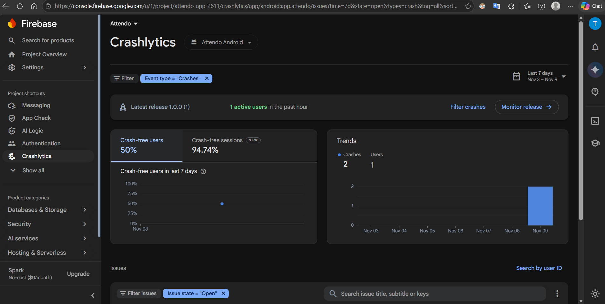{width=31%} 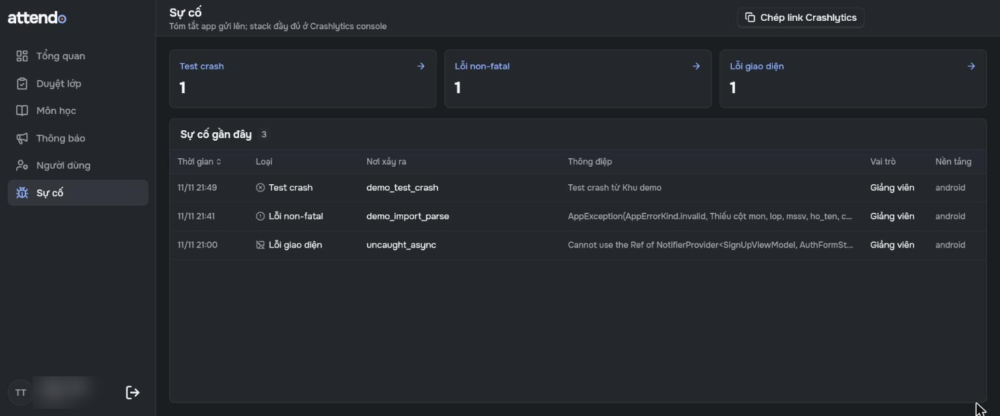{width=31%} 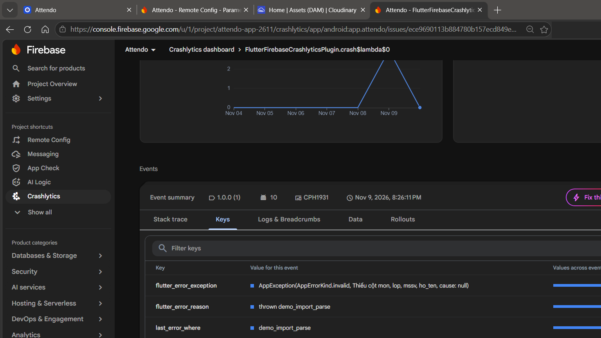{width=31%}

## 6.7 Remote Config

Chín tham số có giá trị mặc định trong app (`firebase/remote-config-defaults.json`). Hai tham số đổi hành vi: `qr_rotate_seconds` (chu kỳ đổi mã) và `absence_limit_percent` (ngưỡng vắng, quyết định danh sách Vắng nhiều). App nghe cập nhật thời gian thực; Khu demo hiện giá trị đang dùng và nguồn.

**Lỗi được xử lý:** không tải được thì dùng giá trị mặc định trong app; trên Windows có thời hạn 15 giây rồi dùng mặc định.

**Bằng chứng trước và sau** (điện thoại thật, 10/11/2026, `evidence/remote-config/`): đổi trên console `qr_rotate_seconds` 12 → 15 và `absence_limit_percent` 20 → 30, không dựng lại app. Khu demo nhận `15s`, `30%`; mục Vắng nhiều đổi từ `6/4`, `5/4` (đỏ, vượt ngưỡng) sang `6/6`, `5/6` (vàng, sát ngưỡng); mở lại mã thì dòng dưới mã đếm **Đổi mã 15s**. Sau đó trả về 12 và 20.

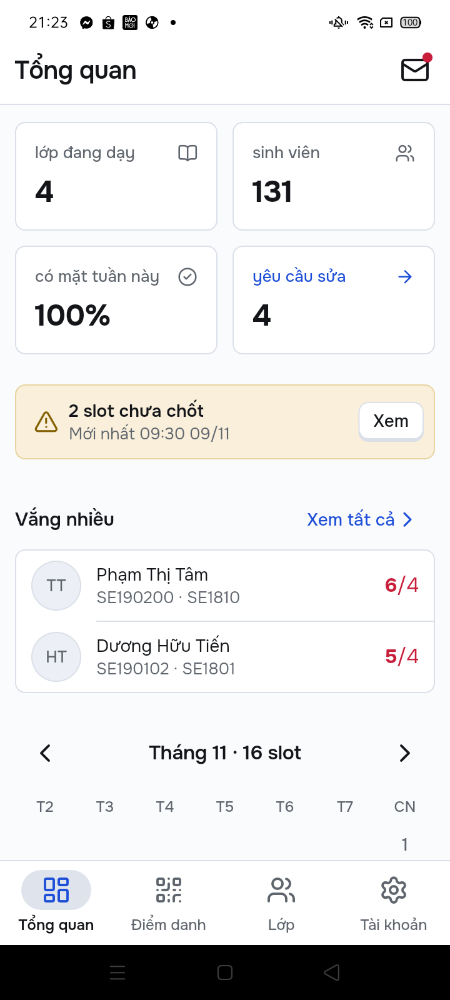{width=17%} 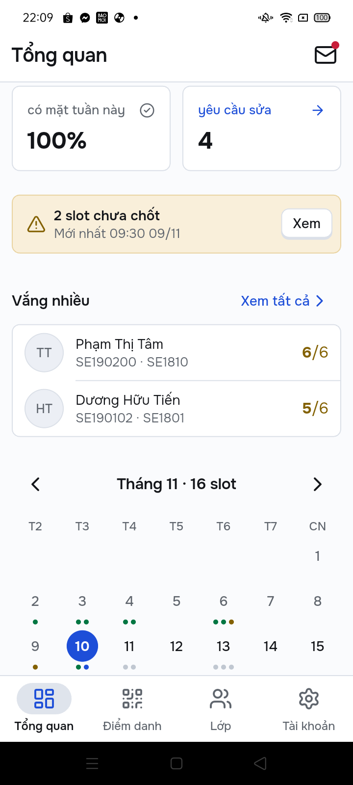{width=17%} 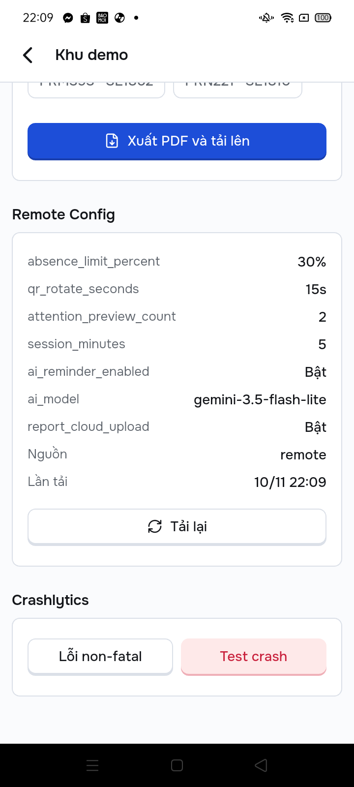{width=17%} 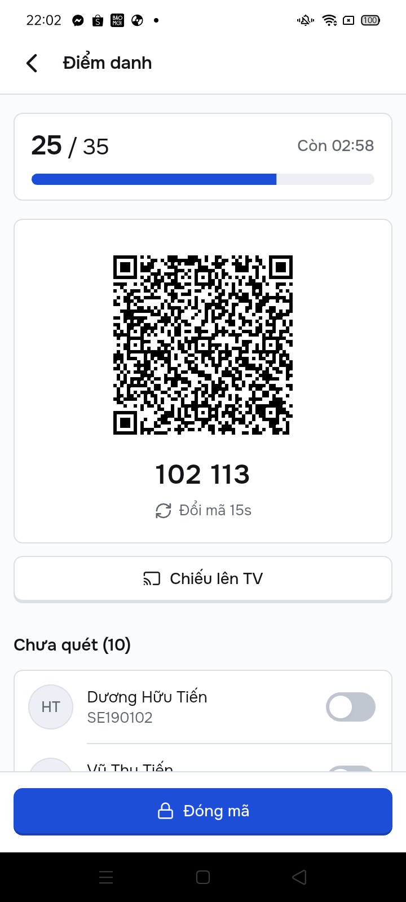{width=17%}

# 7. Kế hoạch sự kiện Analytics

| Sự kiện | ViewModel | Câu hỏi trả lời |
|---|---|---|
| `login`, `sign_up`, `logout` | Login, SignUp, Account | Bao nhiêu người quay lại; Google hay email |
| `import_classes` | Import | File phòng đào tạo có hay lỗi không |
| `attendance_session_open`, `attendance_close` | Session | **TC-1**: mở mã tới chốt mất bao lâu; bao nhiêu em phải bật tay |
| `view_class`, `view_student`, `reminder_send` | ClassDetail, StudentProfile | **TC-3**: hồ sơ mở ra có đúng em sắp chạm ngưỡng không |
| `qr_scan`, `correction_submit`, `correction_review` | Scan, Report, Requests | Quét thất bại vì mã hết hạn bao nhiêu lần |
| `export_report` | ClassDetail | Lớp nào được xuất báo cáo |

Tham số đầy đủ và phễu theo luồng ở `docs/analytics-plan.md`.

# 8. Kiểm thử

| Loại | Công cụ | Kết quả | Nguồn |
|---|---|---|---|
| Unit và widget test | `flutter test` | 59 test app + 11 test web admin đạt | CI run 42742315932, commit `63d8cf9` |
| Phân tích tĩnh | `flutter analyze` | 0 lỗi, 2 gợi ý (info) | như trên |
| Security Rules | Firebase Emulator | 196 ca đạt | Emulator 10/11, CI PR #29 run 42787095197 |
| E2E web | Playwright + Emulator | 33/33 ca đạt | workflow E2E builds, run 42644368921 |
| Test tay trên Firebase thật | 6 ca T1 đến T6 | Đạt, có ảnh trong `evidence/` | `docs/demo/TEST-TAY.md` |
| ARTEMIS trên điện thoại thật | Google ARTEMIS (Flash), 1 lần mỗi ca | 3 ca đạt, 6 ca đạt giao diện, 2 trượt; **chưa đủ 3 lần** (mục 8.1) | `evidence/artemis/results.md` |

## 8.1 ARTEMIS

`docs/test-plan.md` có 17 ca cho Lab 3 (TC-01 đến TC-16, TC-23): 5 đường lỗi, 4 tương tác native (hộp chọn tài khoản Google, bộ chọn file, hộp quyền thông báo, hộp quyền camera), và một phiên khám phá Pro. Mỗi test gửi một chỉ dẫn qua `ArtemisClient`, yêu cầu agent trả JSON rồi assert trên giá trị agent đọc được (số đếm, chữ trên dải lỗi), không chỉ trạng thái. Các widget chính có nhãn `Semantics`. Script `tool/artemis/run-e2e.ps1` chạy cả bộ trên điện thoại thật với Firebase Emulator, nạp lại dữ liệu trước mỗi test để thứ tự không ảnh hưởng.

**Kết quả 11/11/2026** (1 lần mỗi ca, `evidence/artemis/results.md`): đạt TC-02, TC-03, TC-13; TC-04, TC-05, TC-08, TC-11, TC-12, TC-14 đúng phần giao diện nhưng trượt câu kiểm Analytics trong Logcat (máy chưa bật `log.tag.FA VERBOSE`, đã thêm vào fixture); trượt TC-06, TC-15; TC-07 lỗi môi trường (nạp lại dữ liệu thất bại, test không chạy tới bước kiểm); chưa chạy TC-01, TC-16 và ba ca sinh viên (TC-09, TC-10, TC-23). Dừng vì hết ngân sách Gemini (khoảng 355 lượt gọi, 14 đến 87 lượt mỗi ca). Ngày 10/11 trước đó model quá tải (503, 504) rồi hết hạn mức miễn phí (429).

# 9. Review mã bằng AI

| Lượt | Công cụ | Phạm vi | Kết quả |
|---|---|---|---|
| 1 (30/10) | Claude | Mã Lab 3 | CR-01 đến CR-07: 5 nhận, 2 bác; phát hiện nhận đều có commit sửa |
| 3 (02/11) | Claude | Mã Final | CR-08 đến CR-14 |
| 2 (10/11) | CodeRabbit trên PR #28 | ViewModel, service, Security Rules (38 file) | CR-15 đến CR-30: 16 phát hiện, 14 sửa ở PR #29 (mỗi phát hiện một commit), 1 đã sửa trước (CR-16), 1 bác có số đo (CR-30) |
| 2b (10/11) | CodeRabbit trên PR #29 | Các bản sửa lượt 2 và tài liệu đi kèm | CR-31 đến CR-39 về code (8 sửa, 1 bác), 11 ý về tài liệu; Claude đề xuất, sinh viên duyệt cả 9 quyết định |
| 2c (10/11) | CodeRabbit trên PR #30 | Báo cáo, hướng dẫn, các bản sửa lượt 2b | CR-40 đến CR-44 về code (5 sửa, trong đó CR-40 là lỗi bảo mật: mật khẩu mẫu công khai mở được tài khoản Admin trên Firebase thật), 13 ý về tài liệu; đã gộp ở PR #30 |

Mỗi phát hiện có file, loại, quyết định và lý do ở `docs/code-review.md`. Lượt của Claude không độc lập vì chính Claude viết phần lớn mã, nên lượt 2 dùng CodeRabbit (không có GitHub Copilot).

Đáng kể nhất: CR-15 (tự khai MSSV người khác để đọc lịch sử điểm danh; sửa bằng khoá `studentCodes/{mssv}` trong Rules), CR-26 (duyệt đơn cộng thừa một buổi có mặt; sửa bằng transaction), CR-31 (chốt bị server từ chối sau khi mất mạng mà app vẫn báo Đã chốt).

# 10. Khó khăn

- **Cloud Storage cần gói Blaze.** Chuyển sang Cloudinary và ghi khác biệt D-L3-18.
- **Gemini AI Logic bắt buộc App Check** từ 02/11/2026: dùng debug token cho bản demo (quyết định 004).
- **Điện thoại Oppo chặn lệnh xoá dữ liệu app** của ARTEMIS (`CLEAR_APP_USER_DATA`), làm app giữ phiên đăng nhập cũ và đọc nhầm dữ liệu; phải bật "Tắt giám sát quyền" trong tuỳ chọn nhà phát triển.
- **Chi phí và lỗi công cụ ARTEMIS** (mục 8.1): Flash không trả JSON kết quả nên phải vá cục bộ và đọc từ log trace; mỗi ca tốn vài chục lượt gọi Gemini nên không đủ ngân sách chạy 3 lần.
- **App Windows không có đăng nhập Google** vì thư viện Google của Flutter chưa hỗ trợ Windows; giảng viên dùng email trên Windows.

# 11. Bài học

- Ghi bằng chứng ngay khi chạy thật, vì để cuối thì dữ liệu đã đổi, không chụp lại được.
- Test luật bảo mật trên Emulator bắt được lỗi mà test giao diện không thấy (CR-14: giảng viên khác ghi được vào danh sách lớp người khác).
- Test do AI chạy cần đầu vào ổn định: dữ liệu nạp lại trước mỗi test, nhãn `Semantics` rõ ràng, và kiểm hạn mức model trước khi lên lịch chạy.

# 12. Công cụ AI và cấu trúc repo

| Công cụ | Dùng làm gì |
|---|---|
| Claude (Claude Code) | Viết phần lớn mã, test, tài liệu, báo cáo; tự test trên Firebase thật qua điện thoại và trình duyệt |
| Google ARTEMIS | Test E2E trên điện thoại thật |
| CodeRabbit (GitHub app) | Review lượt 2 trên PR #28 đến #30 |
| Gemini (Firebase AI Logic) | Tính năng Gợi ý lời nhắc (phần Final) |

Mỗi phiên làm với AI có một dòng trong `docs/ai-log.md` (ai yêu cầu, AI làm gì, sinh viên kiểm gì, quyết định gì). Quyết định khó sửa lại ở `docs/decisions/`.

**Cấu trúc repo.** Đề Lab 3 đặt mã ở `lib/` gốc. Bản Lab 3 đầu tiên (giao diện cam) giữ nguyên ở nhánh `main`; bản Lab 3 v2 làm trên `ui-v2` rồi gộp vào `final-system`, nơi mã được tách thành `mobile/`, `packages/core/`, `web/` vì bài Final yêu cầu tiếp tục repo Lab 3 với web admin dùng chung lõi.
